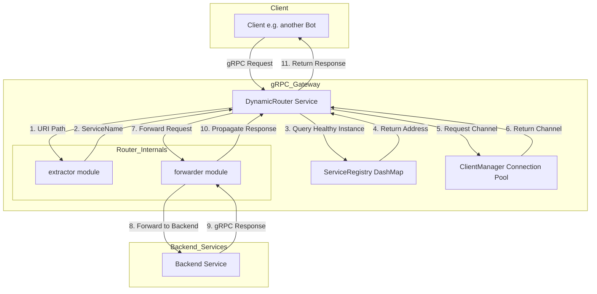

grpc_opizontas/doc/post/post.md
```markdown
# Post Service API 定义

本文档定义了用于访问和查询帖子数据的 gRPC 服务。

## 1. 服务定义 (Service)

### `PostService`

该服务提供了与帖子数据交互的接口。

```protobuf
service PostService {
  // 根据 ID 获取单个帖子的详细信息
  rpc GetPost (GetPostRequest) returns (Post);

  // 根据查询条件获取帖子列表
  rpc QueryPosts (QueryPostsRequest) returns (QueryPostsResponse);
}
```

## 2. 消息定义 (Messages)

### `Post`

帖子的核心数据结构。

```protobuf
message Post {
  string id = 1;         // 帖子的唯一 ID
  string author_id = 2;  // 作者的 Discord 用户 ID
  string channel_id = 3; // 帖子所在的频道 ID
  string title = 4;      // 帖子标题
  string content = 5;    // 帖子内容 (Markdown 或纯文本)
  int64 created_at = 6;  // 创建时间戳 (Unix timestamp)
  repeated string tags = 7; // 标签，用于分类和搜索
  int32 reaction_count = 8; // 帖子的总反应数
  int32 reply_count = 9;    // 帖子的回复消息数
  string image_url = 10;  // 帖子封面图片的 URL
}
```

### `GetPostRequest`

获取单个帖子的请求体。

```protobuf
message GetPostRequest {
  string id = 1; // 要获取的帖子的 ID
  optional string channel_id = 2; // (可选) 帖子所在的频道 ID，用于校验和路由
}
```

### `QueryPostsRequest`

查询帖子的请求体，支持灵活的组合查询和分页。

```protobuf
message QueryPostsRequest {
  optional string author_id = 1;  // 按作者查询
  optional string channel_id = 2; // 按频道查询
  repeated string tags = 3;       // 按标签查询 (查询包含所有指定标签的帖子)
  int32 page_size = 4;            // 分页大小
  int32 page_number = 5;          // 页码
}
```

### `QueryPostsResponse`

查询帖子的响应体。

```protobuf
message QueryPostsResponse {
  repeated Post posts = 1; // 查询到的帖子列表
  int32 total_count = 2;   // 符合条件的总帖子数
}
```
grpc_opizontas/doc/proto/post.proto
```
syntax = "proto3";

package post;

// Service Definition
service PostService {
  // 根据 ID 获取单个帖子的详细信息
  rpc GetPost (GetPostRequest) returns (Post);

  // 根据查询条件获取帖子列表
  rpc QueryPosts (QueryPostsRequest) returns (QueryPostsResponse);
}

// Message Definitions
message Post {
  string id = 1;         // 帖子的唯一 ID
  string author_id = 2;  // 作者的 Discord 用户 ID
  string channel_id = 3; // 帖子所在的频道 ID
  string title = 4;      // 帖子标题
  string content = 5;    // 帖子内容 (Markdown 或纯文本)
  int64 created_at = 6;  // 创建时间戳 (Unix timestamp)
  repeated string tags = 7; // 标签，用于分类和搜索
  int32 reaction_count = 8; // 帖子的总反应数
  int32 reply_count = 9;    // 帖子的回复消息数
  string image_url = 10;  // 帖子封面图片的 URL
}

message GetPostRequest {
  string id = 1; // 要获取的帖子的 ID
  optional string channel_id = 2; // (可选) 帖子所在的频道 ID，用于校验和路由
}

message QueryPostsRequest {
  optional string author_id = 1;  // 按作者查询
  optional string channel_id = 2; // 按频道查询
  repeated string tags = 3;       // 按标签查询 (查询包含所有指定标签的帖子)
  int32 page_size = 4;            // 分页大小
  int32 page_number = 5;          // 页码
}

message QueryPostsResponse {
  repeated Post posts = 1; // 查询到的帖子列表
  int32 total_count = 2;   // 符合条件的总帖子数
}
```

grpc_opizontas/doc/proto/recommendation.proto
```
syntax = "proto3";

package recommendation;

// Service Definition
service RecommendationService {
  // 根据 ID 获取一个安利小纸条
  rpc GetRecommendation (GetRecommendationRequest) returns (RecommendationSlip);

  // 查询一个用户ID全部的小纸条
  rpc GetRecommendationsByAuthor (GetRecommendationsByAuthorRequest) returns (GetRecommendationsByAuthorResponse);
}

// Message Definitions
message RecommendationSlip {
  string id = 1;         // 安利小纸条的唯一 ID
  string author_id = 2;  // 作者的 Discord 用户 ID
  string author_nickname = 3; // 作者当时的昵称
  string content = 4;    // 安利内容
  string post_url = 5;   // 指向相关帖子的 URL
  int32 upvotes = 6;     // 获得的“点赞”数
  int32 questions = 7;   // 获得的“疑问”数
  int32 downvotes = 8;   // 获得的“点踩”数
  int64 created_at = 9;  // 创建时间戳 (Unix timestamp)
  string reviewer_id = 10; // 审定该小纸条的管理员 ID
  int32 is_blocked = 11;  // 标记该小纸条是否已被屏蔽 (0: pending, 1: approved, 2: rejected, 3: ignored)
  string guild_id = 12; // 小纸条所属的 Discord 服务器 ID
  string original_title = 13;
  string original_author = 14;
  string recommend_title = 15;
  string recommend_content = 16;
  string original_post_timestamp = 17;
  string final_amway_message_id = 18;
  bool is_deleted = 19;
  bool is_anonymous = 20;
}

message GetRecommendationRequest {
  string id = 1;
}

message GetRecommendationsByAuthorRequest {
  string author_id = 1;
  string guild_id = 2;
}

message GetRecommendationsByAuthorResponse {
  repeated RecommendationSlip recommendations = 1;
}
```

grpc_opizontas/doc/architecture.md
```markdown
# 项目架构设计

本文档描述了 `grpc_opizontas` 项目的整体代码架构和模块职责。

## 1. 目录结构

```
grpc_opizontas/
├── Cargo.toml
├── build.rs              # 构建脚本，用于编译 .proto 文件
├── config.toml           # 默认配置文件
├── proto/
│   └── registry.proto    # 服务注册 API 定义
├── doc/
│   └── proto/            # 包含后端服务 .proto 文件的示例
│       ├── post.proto
│       └── recommendation.proto
└── src/
    ├── main.rs           # 应用入口，初始化日志和启动服务器
    ├── server.rs         # gRPC 服务器的配置和启动逻辑
    ├── config.rs         # 配置加载与管理模块
    └── services/
        ├── mod.rs        # 声明和导出服务模块
        ├── client_manager.rs # 高性能 gRPC 客户端连接池
        ├── registry_service.rs # 实现服务注册与健康检查逻辑
        └── router/         # 动态请求路由模块
            ├── mod.rs
            ├── error.rs
            ├── extractor.rs
            ├── forwarder.rs
            └── response.rs
```

## 2. 模块职责

*   **`main.rs`**: 程序的唯一入口。负责初始化 `tracing` 日志系统，并调用 `server` 模块来启动 gRPC 网关服务。
*   **`server.rs`**: 核心服务器模块。负责加载配置，初始化并同时注册 `DynamicRouter` 和 `RegistryService`。它将 `DynamicRouter` 作为处理所有未知请求的核心 `tower::Service`，同时显式添加 `RegistryService` 以便处理服务注册的特定请求。
*   **`config.rs`**: 负责从 `config.toml` 文件和环境变量中加载配置。它提供了强类型的配置结构体（如 `SecurityConfig`, `RouterConfig`），并支持环境变量覆盖默认值，为整个应用提供统一的配置访问接口。
*   **`services/`**: 网关的核心功能实现。
    *   **`registry_service.rs`**: 实现了 `RegistryService` gRPC 服务。它使用 `dashmap` 提供线程安全的服务注册表，允许后端服务（Bots）通过 `api_key` 进行安全认证后，注册其地址和所提供的服务。它还管理服务的健康状态（`ServiceHealthStatus`），并包含一个后台任务，用于定期清理心跳超时的过期服务。
    *   **`router/`**: 一个模块化的动态路由层，实现了 `tower::Service` trait。
        *   `mod.rs`: 路由器的核心，负责接收请求，调用 `extractor` 解析服务名，查询注册表获取健康的服务实例，并委托 `forwarder` 进行请求转发。
        *   `extractor.rs`: 负责从传入请求的 URI 路径中解析出 gRPC 的服务名称。
        *   `forwarder.rs`: 负责将请求高效地转发到后端服务。它使用 `client_manager` 获取连接，并管理请求的超时逻辑。
        *   `error.rs` & `response.rs`: 提供统一的错误类型定义和 gRPC 错误响应的构建逻辑。
    *   **`client_manager.rs`**: 实现了一个功能完备的 gRPC 客户端连接池。它负责按需创建、缓存、复用和清理到后端服务的 `tonic::transport::Channel`。该模块包含了连接生命周期管理（TTL、空闲超时）和淘汰策略，以显著提高性能和资源利用率。
*   **`proto/registry.proto`**: 定义了 `RegistryService` 的 gRPC 接口。关键的 `RegisterRequest` 消息中包含了 `api_key` 字段，用于保障注册过程的安全性。
## 3. 数据流与服务发现

`grpc_opizontas` 的核心是一个结合了安全服务注册和高性能动态路由的 gRPC 网关。

### 3.1. 服务注册流程

下图展示了后端服务（Bot）如何安全地向网关注册，以及网关如何维护服务健康状态：

```mermaid
sequenceDiagram
    participant Bot as Backend Bot
    participant Gateway as grpc_opizontas Gateway
    participant Registry as ServiceRegistry (DashMap)
    participant CleanupTask as Background Task

    Bot->>+Gateway: gRPC Call: Register(api_key, address, services)
    Gateway->>Gateway: 1. Validate api_key from config
    alt Invalid Token
        Gateway-->>-Bot: Return Unauthenticated Error
    else Valid Token
        Gateway->>+Registry: 2. Upsert service info {address, last_heartbeat, health_status: Healthy}
        Registry-->>-Gateway: Confirm storage
        Gateway-->>-Bot: Return RegisterResponse {success: true}
    end

    par
        loop Periodic Cleanup
            CleanupTask->>CleanupTask: Sleep for heartbeat_timeout
            CleanupTask->>Registry: 3. Scan for expired services (last_heartbeat > timeout)
            Registry->>Registry: Remove expired entries
        end
    end
```

**注册流程说明:**

1.  **发起注册**: 后端 Bot 启动时，向网关发起 `Register` gRPC 调用。请求中必须包含一个有效的 **`api_key`**，以及自身的网络地址和服务列表。
2.  **安全验证**: 网关的 `RegistryService` 首先会使用 `config.rs` 提供的配置来验证 `api_key` 的有效性。如果无效，则拒绝请求。
3.  **存入注册表**: 验证通过后，服务信息（地址、当前时间作为最后心跳、健康状态设为 `Healthy`）将被存入一个并发安全的 `dashmap` 中。
4.  **后台清理**: `RegistryService` 内部会启动一个独立的 `tokio` 后台任务。该任务会根据配置的 `heartbeat_timeout` 定期运行，扫描注册表并移除所有心跳过期的服务，从而确保路由的可靠性。

### 3.2. 动态请求路由流程

当客户端通过网关请求服务时，`DynamicRouter` 会执行以下流程：



**路由流程说明:**

1.  **接收请求**: 客户端向网关发送 gRPC 请求，例如调用 `post.PostService` 的 `GetPost` 方法。
2.  **解析服务**: 网关的 `DynamicRouter` 接收请求。其内部的 `extractor` 模块从 gRPC 路径 (`/post.PostService/GetPost`) 中解析出服务名 `PostService`。
3.  **查询健康实例**: `DynamicRouter` 查询 `ServiceRegistry`，寻找服务名为 `PostService` 且健康状态为 `Healthy` 的实例地址。
4.  **获取连接**: 查找到地址后，`DynamicRouter` 向 `GrpcClientManager` (连接池) 请求一个到该地址的客户端连接 (`Channel`)。
5.  **连接复用**: `ClientManager` 会检查是否存在到该地址的可用连接。如果存在，则立即返回该连接；如果不存在，则创建一个新连接，存入池中，然后返回。这极大地减少了连接建立的开销。
6.  **转发请求**: `DynamicRouter` 的 `forwarder` 模块使用获取到的 `Channel`，将原始请求（包含超时控制）转发到后端的 `PostService`。
7.  **返回响应**: `PostService` 的响应经由 `forwarder` 和 `DynamicRouter`，最终被返回给原始客户端。

通过这种方式，`grpc_opizontas` 实现了安全、解耦且高性能的动态路由，客户端无需知道后端服务的具体地址，所有服务都可以动态地加入或离开系统。

## 4. 配置与安全

### 4.1. 配置加载

项目的配置由 `src/config.rs` 模块统一管理，遵循一个分层的加载策略：

1.  **默认值**: 在 `Config::default()` 中为所有配置项提供了合理的默认值。
2.  **文件加载**: 程序启动时会尝试读取项目根目录下的 `config.toml` 文件。如果文件存在，其内容将覆盖默认值。
3.  **环境变量覆盖**: 最后，程序会检查特定格式的环境变量（例如 `GRPC_SECURITY_TOKENS`, `GRPC_ROUTER_REQUEST_TIMEOUT`）。如果设置了这些环境变量，它们将覆盖之前从文件或默认值中加载的配置。

这种分层策略提供了高度的灵活性，允许在不同环境（开发、测试、生产）中使用不同的配置，而无需修改代码。

### 4.2. 安全认证

为了保护服务注册接口不被滥用，网关实现了一个基于 Token 的简单安全机制。

*   **配置**: 可接受的 Token（`api_key`）列表在配置的 `security.tokens` 字段中定义。推荐通过环境变量 `GRPC_SECURITY_TOKENS` 来设置，多个 Token 之间用逗号分隔。
*   **验证**: 当后端 Bot 调用 `RegistryService` 的 `Register` 方法时，必须在 `RegisterRequest` 中提供一个有效的 `api_key`。
*   **执行**: `MyRegistryService` 在处理注册请求时，会调用 `config.validate_token()` 方法来检查请求中的 `api_key` 是否存在于配置的 Token 列表中。如果验证失败，将返回 `Unauthenticated` 错误，拒绝本次注册。

这个机制确保了只有受信任的后端服务才能向网关注册自己。
```

grpc_opizontas/doc/init.md
```markdown
# 项目概述: grpc_opizontas

## 1. 项目目标

`grpc_opizontas` 是一个为 "旅程ΟΡΙΖΟΝΤΑΣ" Discord 服务器的 Bot 微服务生态系统设计的高性能 gRPC 通信网关。

它的核心目标是提供一个统一、稳定、可扩展的通信中枢，以解耦各个功能独立的 Bot 微服务（例如，使用 Go、Python、JavaScript 等不同语言编写的 Bot），使它们可以高效、安全地进行交互。

## 2. 核心架构

本项目被设计为一个**具备服务发现能力的高性能 gRPC 路由网关**。它不直接处理核心业务逻辑，而是专注于网络通信的中间层。

其主要职责包括：

*   **安全的服务注册**: 提供 `RegistryService`，允许下游 Bot 通过 `api_key` 安全地注册自身。
*   **动态服务发现与路由**: 拦截所有 gRPC 请求，根据服务名在注册表中查找健康的实例，并将请求动态转发。
*   **服务健康检查**: 自动监控已注册服务的心跳，并剔除无响应的实例，保证路由的高可用性。
*   **高性能连接池**: 管理到下游服务的 gRPC 连接，通过复用和智能回收机制减少延迟。

更详细的架构设计、目录结构和数据流图，请参阅 [项目架构设计文档](./architecture.md)。

## 3. API 服务

本项目通过 Protobuf 定义服务，这些服务构成了微服务之间通信的契约。

*   **`RegistryService` (由网关提供)**: 允许后端 Bot 进行服务注册和心跳维持。这是网关的核心管理服务。
*   **`PostService` (下游服务示例)**: 提供帖子的查询功能。
    *   [详细 API 定义](./post/post.md)
*   **`RecommendationService` (下游服务示例)**: 提供对“安利小纸条”的获取、删除和屏蔽功能。
    *   [详细 API 定义](./post/recommendation_api.md)
*   **`BotCommunicator` (待定)**: 负责通用的机器人间通信。

所有 API 定义都遵循 gRPC 的最佳实践，旨在实现跨语言的互操作性。

## 4. 技术选型

*   **语言**: [Rust](https://www.rust-lang.org/) - 以其高性能、内存安全和并发能力而著称。
*   **gRPC 框架**: [Tonic](https://github.com/hyperium/tonic) - 一个纯 Rust 实现的高性能 gRPC 框架。
*   **异步运行时**: [Tokio](https://tokio.rs/) - Rust 生态中最成熟的异步运行时。
*   **并发数据结构**: [DashMap](https://github.com/xacrimon/dashmap) - 用于实现高性能、线程安全的服务注册表。
*   **配置与序列化**: [Serde](https://serde.rs/) 和 [TOML](https://toml.io/en/) - 用于灵活的配置文件处理。
*   **API 定义语言**: [Protocol Buffers (proto3)](https://developers.google.com/protocol-buffers) - 用于定义 gRPC 服务和消息。
```

grpc_opizontas/doc/USAGE_GUIDE.md
```markdown
# 使用指南

本文档将指导您如何作为 **服务提供端** 将您的服务接入网关，以及如何作为 **客户端** 通过网关调用这些服务。

## 快速开始

### 1. 启动网关服务器

在开始之前，请确保网关服务器正在运行。在一个终端中启动网关：

```bash
cargo run
```

您应该看到类似以下的输出，表明网关已成功启动并监听在 `0.0.0.0:50051`：

```
INFO grpc_opizontas: Starting gateway server...
INFO grpc_opizontas::server: Security configuration loaded successfully
INFO grpc_opizontas::server: Gateway server listening on 0.0.0.0:50051 with registry service
INFO grpc_opizontas::server: Dynamic routing enabled for all gRPC requests
```

---

## Part 1: 面向服务提供端 (如何注册您的服务)

作为服务开发者，您需要将您的 gRPC 服务注册到网关，以便客户端可以发现和调用它。

### 核心概念

1.  **服务注册**: 在您的服务启动时，您必须向网关发送一个注册请求。这个请求告诉网关您的服务名称、监听地址以及用于认证的 `api_key`。
2.  **服务心跳**: 为了让网关知道您的服务仍然存活，您必须定期（例如每30秒）重新发送注册请求。这本质上是一个心跳机制。如果网关在配置的超时时间（默认为120秒）内没有收到心跳，它将认为您的服务已下线并将其从注册表中移除。
3.  **API Key**: 每次注册或心跳请求都必须包含一个有效的 `api_key`。这个密钥用于认证，确保只有受信任的服务才能注册到网关。

### 步骤1: 定义您的 `.proto` 文件

首先，定义您的 gRPC 服务。例如，一个简单的 `PostService`：

```proto
// proto/post.proto
syntax = "proto3";

package post;

service PostService {
  rpc GetPost(GetPostRequest) returns (GetPostResponse);
}

message GetPostRequest {
  string post_id = 1;
}

message GetPostResponse {
  string title = 1;
  string content = 2;
}
```

### 步骤2: 实现并注册您的服务

接下来，在您的 Rust 微服务中，您需要：
1.  实现 `PostService`。
2.  连接到网关的 `RegistryService`。
3.  在启动时注册服务，并启动一个异步任务来定期发送心跳。

这是一个完整的示例：

```rust
// main.rs of your microservice
use std::time::Duration;
use tonic::{transport::Server, Request, Response, Status};
use tokio::time::interval;

// 假设这些是由 tonic-build 生成的代码
use post::post_service_server::{PostService, PostServiceServer};
use post::{GetPostRequest, GetPostResponse};

// 网关注册服务的客户端
use registry::registry_service_client::RegistryServiceClient;
use registry::RegisterRequest;

// 替换为您自己的模块路径
mod post {
    tonic::include_proto!("post");
}
mod registry {
    tonic::include_proto!("registry");
}

const SERVICE_NAME: &str = "PostService";
const SERVICE_ADDRESS: &str = "http://post-service:50052"; // 您的服务监听地址
const GATEWAY_ADDRESS: &str = "http://gateway:50051"; // 网关地址
const API_KEY: &str = "your-secret-token"; // 必须与网关配置匹配

#[derive(Default)]
pub struct MyPostService {}

#[tonic::async_trait]
impl PostService for MyPostService {
    async fn get_post(&self, request: Request<GetPostRequest>) -> Result<Response<Post>, Status> {
        let post_id = request.into_inner().post_id;
        println!("Received request for post: {}", post_id);
        let reply = Post {
            id: post_id,
            author_id: "user-123".to_string(),
            channel_id: "channel-456".to_string(),
            title: "Hello from PostService!".to_string(),
            content: "This is a sample post.".to_string(),
            created_at: chrono::Utc::now().timestamp(),
            tags: vec!["rust".to_string(), "grpc".to_string()],
            reaction_count: 0,
            reply_count: 0,
            image_url: "".to_string(),
        };
        Ok(Response::new(reply))
    }
}

async fn start_heartbeat() {
    loop {
        let mut interval = interval(Duration::from_secs(30));
        interval.tick().await; // 第一次立即执行

        println!("Connecting to gateway for heartbeat...");
        match RegistryServiceClient::connect(GATEWAY_ADDRESS).await {
            Ok(mut client) => {
                let request = Request::new(RegisterRequest {
                    api_key: API_KEY.to_string(),
                    address: SERVICE_ADDRESS.to_string(),
                    services: vec![SERVICE_NAME.to_string()],
                });
                if let Err(e) = client.register(request).await {
                    eprintln!("Failed to send heartbeat: {}", e);
                } else {
                    println!("Heartbeat sent successfully for {}", SERVICE_NAME);
                }
            }
            Err(e) => {
                eprintln!("Failed to connect to gateway: {}", e);
            }
        }
    }
}

#[tokio::main]
async fn main() -> Result<(), Box<dyn std::error::Error>> {
    let addr = "0.0.0.0:50052".parse()?;
    let post_service = MyPostService::default();

    // 启动心跳任务
    tokio::spawn(start_heartbeat());

    println!("PostService listening on {}", addr);
    Server::builder()
        .add_service(PostServiceServer::new(post_service))
        .serve(addr)
        .await?;

    Ok(())
}
```

---

## Part 2: 面向客户端 (如何通过网关调用服务)

作为客户端开发者，您不需要知道后端服务的具体地址。您只需要将所有请求发送到网关，并使用 `package.ServiceName/Method` 格式的路径即可。

### 核心概念

1.  **统一入口**: 网关是所有 gRPC 请求的唯一入口。
2.  **动态路由**: 网关会解析请求的 URL 路径（例如 `/post.PostService/GetPost`），提取服务名 `PostService`，然后在内部注册表中查找该服务的地址，最后将请求转发过去。
3.  **位置透明性**: 对客户端而言，后端服务的位置是完全透明的。您只需要与网关交互。

### 示例1: 使用 `grpcurl` (用于测试和调试)

`grpcurl` 是一个强大的命令行工具，非常适合用来测试 gRPC 服务。

```bash
# -plaintext: 因为默认配置下网关未使用TLS
# localhost:50051: 网关的地址
# post.PostService/GetPost: 调用的方法，格式为 package.Service/Method
# -d '{"post_id": "123"}': 请求的数据体 (JSON格式)

grpcurl -plaintext -d '{"post_id": "123"}' localhost:50051 post.PostService/GetPost
```

> **技术细节说明：路径解析**
> 网关的路由逻辑会解析请求路径 `/package.ServiceName/MethodName`，并提取点号 (`.`)之后的 `ServiceName` 作为服务的唯一标识符进行查找。该行为定义在 [`src/services/router/extractor.rs`](src/services/router/extractor.rs)。因此，请确保您的客户端始终使用标准的 `package.ServiceName` 格式。

如果一切正常，您将收到来自 `PostService` 的响应：

```json
{
  "title": "Hello from PostService!",
  "content": "This is a sample post."
}
```

### 示例2: 使用 Rust Tonic 客户端

在您的 Rust 客户端代码中，您只需要连接到网关地址，然后像调用普通 gRPC 服务一样调用目标服务。

```rust
// main.rs of your client application
use tonic::Request;

// 假设这是由 tonic-build 生成的代码
use post::post_service_client::PostServiceClient;
use post::GetPostRequest;

// 替换为您自己的模块路径
mod post {
    tonic::include_proto!("post");
}

const GATEWAY_ADDRESS: &str = "http://localhost:50051"; // 始终连接到网关

#[tokio::main]
async fn main() -> Result<(), Box<dyn std::error::Error>> {
    // 1. 连接到网关，而不是直接连接到 PostService
    let mut client = PostServiceClient::connect(GATEWAY_ADDRESS).await?;

    // 2. 创建一个发往 PostService 的请求
    let request = Request::new(GetPostRequest {
        post_id: "456".to_string(),
    });

    // 3. 发送请求
    // Tonic 会自动将请求路径设置为 /post.PostService/GetPost
    // 网关会解析此路径并进行转发
    let response = client.get_post(request).await?;

    let post = response.into_inner();
    println!("Received Post: {} - {}", post.title, post.content);

    Ok(())
}
```

## 配置与故障排除

有关详细的配置选项、监控和故障排除指南，请参阅文档的后续部分。
```

grpc_opizontas/proto/registry.proto
```
syntax = "proto3";

package registry;

// 服务发现服务，由网关提供
service RegistryService {
  rpc Register(RegisterRequest) returns (RegisterResponse);
  // 建立反向连接的双向流
  rpc EstablishConnection(stream ConnectionMessage) returns (stream ConnectionMessage);
}

message RegisterRequest {
  // API 密钥，用于身份验证
  string api_key = 1;
  // Bot 的网络地址, 例如 "http://bot-a:50051"
  string address = 2;
  // Bot 提供的 gRPC 服务名称列表
  repeated string services = 3;
}

message RegisterResponse {
  // 注册是否成功
  bool success = 1;
  // 可选的返回消息
  string message = 2;
}

// 反向连接消息类型
message ConnectionMessage {
  oneof message_type {
    // 微服务连接注册
    ConnectionRegister register = 1;
    // 网关推送的请求
    ForwardRequest request = 2;
    // 微服务返回的响应
    ForwardResponse response = 3;
    // 心跳消息
    Heartbeat heartbeat = 4;
    // 连接状态消息
    ConnectionStatus status = 5;
  }
}

// 连接注册消息
message ConnectionRegister {
  // API 密钥，用于身份验证
  string api_key = 1;
  // 微服务提供的 gRPC 服务名称列表
  repeated string services = 2;
  // 可选的连接标识符
  string connection_id = 3;
}

// 转发请求消息
message ForwardRequest {
  // 请求唯一标识符
  string request_id = 1;
  // gRPC 方法路径 (例如: /post.PostService/GetPost)
  string method_path = 2;
  // 请求头部
  map<string, string> headers = 3;
  // 请求体 (protobuf 编码的字节)
  bytes payload = 4;
  // 超时时间 (秒)
  int32 timeout_seconds = 5;
  
  // 流式传输支持
  StreamingInfo streaming_info = 6;
}

// 流式传输信息
message StreamingInfo {
  // 流式传输类型
  enum StreamType {
    // 一元调用（默认）
    UNARY = 0;
    // 客户端流
    CLIENT_STREAMING = 1;
    // 服务端流
    SERVER_STREAMING = 2;
    // 双向流
    BIDIRECTIONAL_STREAMING = 3;
  }
  
  StreamType stream_type = 1;
  // 是否为流的结束标记
  bool is_stream_end = 2;
  // 流序列号（用于排序）
  int64 sequence_number = 3;
  // 流数据块大小（字节）
  int32 chunk_size = 4;
}

// 转发响应消息
message ForwardResponse {
  // 对应的请求ID
  string request_id = 1;
  // 响应状态码
  int32 status_code = 2;
  // 响应头部
  map<string, string> headers = 3;
  // 响应体 (protobuf 编码的字节)
  bytes payload = 4;
  // 错误消息 (如果有)
  string error_message = 5;
  
  // 流式传输支持
  StreamingInfo streaming_info = 6;
  
  // 响应体流式传输支持
  ResponseStreamInfo response_stream_info = 7;
}

// 响应体流式传输信息
message ResponseStreamInfo {
  // 是否为流式响应
  bool is_streamed = 1;
  // 当前块在流中的索引
  int64 chunk_index = 2;
  // 是否为最后一个块
  bool is_final_chunk = 3;
  // 当前块大小
  int32 chunk_size = 4;
  // 总响应大小（如果已知）
  optional int64 total_size = 5;
}

// 心跳消息
message Heartbeat {
  // 时间戳
  int64 timestamp = 1;
  // 连接ID
  string connection_id = 2;
}

// 连接状态消息
message ConnectionStatus {
  // 连接ID
  string connection_id = 1;
  // 状态类型
  enum StatusType {
    CONNECTED = 0;
    DISCONNECTED = 1;
    ERROR = 2;
  }
  StatusType status = 2;
  // 可选的状态消息
  string message = 3;
}
```

grpc_opizontas/src/config.rs
```rust
use serde::{Deserialize, Serialize};
use std::fs;
use std::time::Duration;

#[derive(Debug, Clone, Serialize, Deserialize)]
pub struct Config {
    pub security: SecurityConfig,
    pub router: RouterConfig,
    pub connection_pool: ConnectionPoolConfig,
    pub reverse_connection: ReverseConnectionConfig,
    pub server: ServerConfig,
}

#[derive(Debug, Clone, Serialize, Deserialize)]
pub struct RouterConfig {
    pub heartbeat_timeout: u64,
    pub request_timeout: u64,
    pub retry_attempts: u32,
    pub max_concurrent_requests: usize,
}

#[derive(Debug, Clone, Serialize, Deserialize)]
pub struct ConnectionPoolConfig {
    pub max_connections: usize,
    pub connection_ttl: u64,
    pub idle_timeout: u64,
    pub cleanup_interval: u64,
}

#[derive(Debug, Clone, Serialize, Deserialize)]
pub struct ReverseConnectionConfig {
    pub heartbeat_timeout: u64,
    pub request_timeout: u64,
    pub cleanup_interval: u64,
    pub max_pending_requests: usize,
}

#[derive(Debug, Clone, Serialize, Deserialize)]
pub struct ServerConfig {
    pub address: String,
    pub log_level: String,
}

#[derive(Debug, Clone, Serialize, Deserialize)]
pub struct SecurityConfig {
    pub tokens: Vec<String>,
}

// 环境变量配置结构
#[derive(Debug, Deserialize)]
struct EnvConfig {
    #[serde(default)]
    grpc_security_tokens: Option<String>,
    #[serde(default)]
    grpc_router_heartbeat_timeout: Option<u64>,
    #[serde(default)]
    grpc_router_request_timeout: Option<u64>,
    #[serde(default)]
    grpc_router_retry_attempts: Option<u32>,
    #[serde(default)]
    grpc_router_max_concurrent_requests: Option<usize>,
    #[serde(default)]
    grpc_pool_max_connections: Option<usize>,
    #[serde(default)]
    grpc_pool_connection_ttl: Option<u64>,
    #[serde(default)]
    grpc_pool_idle_timeout: Option<u64>,
    #[serde(default)]
    grpc_pool_cleanup_interval: Option<u64>,
    #[serde(default)]
    grpc_reverse_heartbeat_timeout: Option<u64>,
    #[serde(default)]
    grpc_reverse_request_timeout: Option<u64>,
    #[serde(default)]
    grpc_reverse_cleanup_interval: Option<u64>,
    #[serde(default)]
    grpc_reverse_max_pending_requests: Option<usize>,
    #[serde(default)]
    grpc_server_address: Option<String>,
    #[serde(default)]
    grpc_log_level: Option<String>,
}

impl Config {
    pub fn load() -> Result<Self, Box<dyn std::error::Error>> {
        // 加载 .env 文件（如果存在）
        let _ = dotenvy::dotenv();

        // 从文件加载基础配置
        let mut config = Self::load_from_file().unwrap_or_else(|_| Self::default());

        // 应用环境变量覆盖
        config.apply_env_overrides()?;

        Ok(config)
    }

    fn load_from_file() -> Result<Self, Box<dyn std::error::Error>> {
        let config_str = fs::read_to_string("config.toml")?;
        let config: Config = toml::from_str(&config_str)?;
        Ok(config)
    }

    fn apply_env_overrides(&mut self) -> Result<(), Box<dyn std::error::Error>> {
        let env_config: EnvConfig = envy::from_env()?;

        // 安全配置覆盖
        if let Some(tokens_str) = env_config.grpc_security_tokens {
            self.security.tokens = tokens_str
                .split(',')
                .map(|s| s.trim().to_string())
                .filter(|s| !s.is_empty())
                .collect();
        }

        // 路由配置覆盖
        if let Some(val) = env_config.grpc_router_heartbeat_timeout {
            self.router.heartbeat_timeout = val;
        }
        if let Some(val) = env_config.grpc_router_request_timeout {
            self.router.request_timeout = val;
        }
        if let Some(val) = env_config.grpc_router_retry_attempts {
            self.router.retry_attempts = val;
        }
        if let Some(val) = env_config.grpc_router_max_concurrent_requests {
            self.router.max_concurrent_requests = val;
        }

        // 连接池配置覆盖
        if let Some(val) = env_config.grpc_pool_max_connections {
            self.connection_pool.max_connections = val;
        }
        if let Some(val) = env_config.grpc_pool_connection_ttl {
            self.connection_pool.connection_ttl = val;
        }
        if let Some(val) = env_config.grpc_pool_idle_timeout {
            self.connection_pool.idle_timeout = val;
        }
        if let Some(val) = env_config.grpc_pool_cleanup_interval {
            self.connection_pool.cleanup_interval = val;
        }

        // 反向连接配置覆盖
        if let Some(val) = env_config.grpc_reverse_heartbeat_timeout {
            self.reverse_connection.heartbeat_timeout = val;
        }
        if let Some(val) = env_config.grpc_reverse_request_timeout {
            self.reverse_connection.request_timeout = val;
        }
        if let Some(val) = env_config.grpc_reverse_cleanup_interval {
            self.reverse_connection.cleanup_interval = val;
        }
        if let Some(val) = env_config.grpc_reverse_max_pending_requests {
            self.reverse_connection.max_pending_requests = val;
        }

        // 服务器配置覆盖
        if let Some(val) = env_config.grpc_server_address {
            self.server.address = val;
        }
        if let Some(val) = env_config.grpc_log_level {
            self.server.log_level = val;
        }

        Ok(())
    }

    pub fn validate_token(&self, token: &str) -> bool {
        self.security.tokens.contains(&token.to_string())
    }

    // 获取路由配置的便利方法
    pub fn heartbeat_timeout(&self) -> Duration {
        Duration::from_secs(self.router.heartbeat_timeout)
    }

    pub fn request_timeout(&self) -> Duration {
        Duration::from_secs(self.router.request_timeout)
    }
}

impl Default for Config {
    fn default() -> Self {
        Self {
            security: SecurityConfig {
                tokens: vec![], // 默认无 token，必须通过环境变量设置
            },
            router: RouterConfig {
                heartbeat_timeout: 120,
                request_timeout: 30,
                retry_attempts: 3,
                max_concurrent_requests: 1000,
            },
            connection_pool: ConnectionPoolConfig {
                max_connections: 100,
                connection_ttl: 300,
                idle_timeout: 60,
                cleanup_interval: 30,
            },
            reverse_connection: ReverseConnectionConfig {
                heartbeat_timeout: 120,
                request_timeout: 30,
                cleanup_interval: 60,
                max_pending_requests: 1000,
            },
            server: ServerConfig {
                address: "0.0.0.0:50051".to_string(),
                log_level: "info".to_string(),
            },
        }
    }
}

```

grpc_opizontas/src/main.rs
```rust
pub mod registry {
    tonic::include_proto!("registry");
}
pub mod config;
pub mod server;
pub mod services;

use jemallocator::Jemalloc;
use tracing_subscriber::{EnvFilter, FmtSubscriber};
#[global_allocator]
static GLOBAL: Jemalloc = Jemalloc;
#[tokio::main]
async fn main() -> Result<(), Box<dyn std::error::Error>> {
    // 初始化 tracing
    let subscriber = FmtSubscriber::builder()
        .with_env_filter(EnvFilter::from_default_env())
        .finish();
    tracing::subscriber::set_global_default(subscriber).expect("setting default subscriber failed");

    tracing::info!("Starting gateway server...");
    server::start().await?;
    Ok(())
}

```

grpc_opizontas/src/server.rs
```rust
use crate::config::Config;
use crate::registry::registry_service_server::RegistryServiceServer;
use crate::services::registry::MyRegistryService;
use crate::services::router::DynamicRouter;
use tonic::transport::Server;

pub async fn start() -> Result<(), Box<dyn std::error::Error>> {
    let addr = "0.0.0.0:50051".parse()?;

    // 加载配置
    let config = Config::load()?;
    tracing::info!("Security configuration loaded successfully");

    // 创建服务实例
    let registry_service = MyRegistryService::new(config.clone());
    let registry = registry_service.registry.clone();
    let reverse_manager = registry_service.reverse_connection_manager.clone();

    // 创建动态路由器
    let router = DynamicRouter::new(registry.clone(), config.clone(), reverse_manager);

    tracing::info!("Gateway server listening on {} with registry service", addr);
    tracing::info!("Dynamic routing enabled for all gRPC requests");

    // 启动服务器，将动态路由器作为主要的服务处理器
    // 注册服务请求会被动态路由器识别并转发到注册服务
    Server::builder()
        .add_service(tower::ServiceBuilder::new().service(router))
        .add_service(RegistryServiceServer::new(registry_service))
        .serve(addr)
        .await?;

    Ok(())
}

```

grpc_opizontas/src/services/client/config.rs
```rust
use std::time::Duration;

/// 网关客户端配置
#[derive(Debug, Clone)]
pub struct GatewayClientConfig {
    /// 网关地址
    pub gateway_address: String,
    /// 默认超时时间
    pub default_timeout: Duration,
    /// 连接超时时间
    pub connect_timeout: Duration,
    /// API 密钥
    pub api_key: String,
}

impl Default for GatewayClientConfig {
    fn default() -> Self {
        Self {
            gateway_address: "http://localhost:50051".to_string(),
            default_timeout: Duration::from_secs(30),
            connect_timeout: Duration::from_secs(10),
            api_key: String::new(),
        }
    }
}
```

grpc_opizontas/src/services/client/error.rs
```rust
use tonic::Status;

/// 网关客户端错误类型
#[derive(Debug, thiserror::Error)]
pub enum GatewayClientError {
    #[error("Transport error: {0}")]
    Transport(#[from] tonic::transport::Error),
    #[error("gRPC error: {0}")]
    Grpc(#[from] Status),
    #[error("Serialization error: {0}")]
    Serialization(String),
    #[error("Timeout error")]
    Timeout,
    #[error("Service not found: {0}")]
    ServiceNotFound(String),
}
```

grpc_opizontas/src/services/client/generic.rs
```rust
use super::error::GatewayClientError;

/// 静态方法：序列化消息（优化内存使用）
pub fn serialize_message_static<T: prost::Message>(message: &T) -> Result<Vec<u8>, GatewayClientError> {
    // 估算消息大小以减少重新分配
    let estimated_size = message.encoded_len();
    let mut buf = bytes::BytesMut::with_capacity(estimated_size);
    
    message.encode(&mut buf)
        .map_err(|e| GatewayClientError::Serialization(e.to_string()))?;
    
    // 转换为Vec<u8>以保持API兼容性
    Ok(buf.to_vec())
}

/// 静态方法：反序列化响应
pub fn deserialize_response_static<R: prost::Message + Default>(response_bytes: Vec<u8>) -> Result<R, GatewayClientError> {
    R::decode(&response_bytes[..])
        .map_err(|e| GatewayClientError::Serialization(e.to_string()))
}
```

grpc_opizontas/src/services/client/mod.rs
```rust
pub mod config;
pub mod error;
pub mod generic;
pub(crate) mod streaming;

pub use config::*;
pub use error::*;
```

grpc_opizontas/src/services/client/streaming.rs
```rust
use std::collections::HashMap;
use tokio::sync::mpsc;
use tokio_stream::{Stream, StreamExt};
use tonic::Status;
use uuid::Uuid;
use crate::registry::{
    ForwardRequest, StreamingInfo,
    streaming_info::StreamType,
};
use crate::services::gateway_client::GatewayClient;
use super::GatewayClientError;


/// 启动请求发送任务
pub(crate) async fn spawn_request_sender<T>(
    client: &GatewayClient,
    requests: impl Stream<Item = T> + Send + Unpin + 'static,
    request_tx: mpsc::Sender<ForwardRequest>,
    service_name: &str,
    method_path: &str,
) where
    T: prost::Message + Send + 'static,
{
    let service_name = service_name.to_string();
    let method_path = method_path.to_string();
    let timeout = client.config.default_timeout.as_secs() as i32;
    
    tokio::spawn(async move {
        let mut sequence_number = 0i64;
        let mut requests = requests;
        
        while let Some(request_item) = requests.next().await {
            let payload = match super::generic::serialize_message_static(&request_item) {
                Ok(p) => p,
                Err(_) => break,
            };
            
            let mut headers = HashMap::new();
            headers.insert("x-service-name".to_string(), service_name.clone());
            
            let forward_request = ForwardRequest {
                request_id: Uuid::new_v4().to_string(),
                method_path: method_path.clone(),
                headers,
                payload,
                timeout_seconds: timeout,
                streaming_info: Some(StreamingInfo {
                    stream_type: StreamType::BidirectionalStreaming as i32,
                    is_stream_end: false,
                    sequence_number,
                    chunk_size: 0,
                }),
            };
            
            sequence_number += 1;
            if request_tx.send(forward_request).await.is_err() {
                break;
            }
        }
        
        // 发送结束标记
        let mut end_headers = HashMap::new();
        end_headers.insert("x-service-name".to_string(), service_name);
        
        let end_request = ForwardRequest {
            request_id: Uuid::new_v4().to_string(),
            method_path,
            headers: end_headers,
            payload: Vec::new(),
            timeout_seconds: timeout,
            streaming_info: Some(StreamingInfo {
                stream_type: StreamType::BidirectionalStreaming as i32,
                is_stream_end: true,
                sequence_number,
                chunk_size: 0,
            }),
        };
        
        let _ = request_tx.send(end_request).await;
    });
}

/// 启动响应处理任务
pub(crate) async fn spawn_response_handler<R>(
    mut inbound: impl Stream<Item = Result<crate::registry::ConnectionMessage, Status>> + Send + Unpin + 'static,
    response_tx: mpsc::Sender<Result<R, GatewayClientError>>,
) where
    R: prost::Message + Default + Send + 'static,
{
    tokio::spawn(async move {
        while let Some(message_result) = inbound.next().await {
            match message_result {
                Ok(message) => {
                    if let Some(crate::registry::connection_message::MessageType::Response(response)) = message.message_type {
                        let result = super::generic::deserialize_response_static::<R>(response.payload);
                        
                        if response_tx.send(result).await.is_err() {
                            break;
                        }
                        
                        // 检查流结束
                        if let Some(streaming_info) = response.streaming_info
                            && streaming_info.is_stream_end {
                                break;
                            }
                    }
                }
                Err(e) => {
                    let _ = response_tx.send(Err(GatewayClientError::Grpc(e))).await;
                    break;
                }
            }
        }
    });
}

/// 发送客户端流请求
pub(crate) fn send_client_stream_requests<T>(
    client: &GatewayClient,
    requests: impl Iterator<Item = T> + Send + 'static,
    request_tx: mpsc::Sender<ForwardRequest>,
    service_name: &str,
    method_path: &str,
) where
    T: prost::Message + Send + 'static,
{
    let service_name = service_name.to_string();
    let method_path = method_path.to_string();
    let timeout = client.config.default_timeout.as_secs() as i32;
    
    tokio::spawn(async move {
        let mut sequence_number = 0i64;
        
        // 发送所有请求
        for request_item in requests {
            let Ok(payload) = super::generic::serialize_message_static(&request_item) else {
                break;
            };
            
            let mut headers = HashMap::new();
            headers.insert("x-service-name".to_string(), service_name.clone());
            
            let forward_request = ForwardRequest {
                request_id: Uuid::new_v4().to_string(),
                method_path: method_path.clone(),
                headers,
                payload,
                timeout_seconds: timeout,
                streaming_info: Some(StreamingInfo {
                    stream_type: StreamType::ClientStreaming as i32,
                    is_stream_end: false,
                    sequence_number,
                    chunk_size: 0,
                }),
            };
            
            sequence_number += 1;
            if request_tx.send(forward_request).await.is_err() {
                break;
            }
        }
        
        // 发送结束标记
        let mut end_headers = HashMap::new();
        end_headers.insert("x-service-name".to_string(), service_name);
        
        let end_request = ForwardRequest {
            request_id: Uuid::new_v4().to_string(),
            method_path,
            headers: end_headers,
            payload: Vec::new(),
            timeout_seconds: timeout,
            streaming_info: Some(StreamingInfo {
                stream_type: StreamType::ClientStreaming as i32,
                is_stream_end: true,
                sequence_number,
                chunk_size: 0,
            }),
        };
        
        let _ = request_tx.send(end_request).await;
    });
}

/// 发送服务端流请求
pub(crate) fn send_server_stream_request<T>(
    client: &GatewayClient,
    request: T,
    request_tx: mpsc::Sender<ForwardRequest>,
    service_name: &str,
    method_path: &str,
) where
    T: prost::Message + Send + 'static,
{
    let service_name = service_name.to_string();
    let method_path = method_path.to_string();
    let timeout = client.config.default_timeout.as_secs() as i32;
    
    tokio::spawn(async move {
        let Ok(payload) = super::generic::serialize_message_static(&request) else {
            return;
        };
        
        let mut headers = HashMap::new();
        headers.insert("x-service-name".to_string(), service_name);
        
        let forward_request = ForwardRequest {
            request_id: Uuid::new_v4().to_string(),
            method_path,
            headers,
            payload,
            timeout_seconds: timeout,
            streaming_info: Some(StreamingInfo {
                stream_type: StreamType::ServerStreaming as i32,
                is_stream_end: false,
                sequence_number: 0,
                chunk_size: 0,
            }),
        };
        
        let _ = request_tx.send(forward_request).await;
    });
}

/// 启动服务端流响应处理任务
pub(crate) fn spawn_server_stream_handler<R>(
    mut inbound: tonic::Streaming<crate::registry::ConnectionMessage>,
    response_tx: mpsc::Sender<Result<R, GatewayClientError>>,
) where
    R: prost::Message + Default + Send + 'static,
{
    tokio::spawn(async move {
        while let Some(message_result) = inbound.next().await {
            let message = match message_result {
                Ok(msg) => msg,
                Err(e) => {
                    let _ = response_tx.send(Err(GatewayClientError::Grpc(e))).await;
                    break;
                }
            };
            
            let Some(crate::registry::connection_message::MessageType::Response(response)) = message.message_type else {
                continue;
            };
            
            let result = super::generic::deserialize_response_static::<R>(response.payload);
            
            if response_tx.send(result).await.is_err() {
                break;
            }
            
            // 检查流结束标记
            if let Some(streaming_info) = response.streaming_info
                && streaming_info.is_stream_end {
                break;
            }
        }
    });
}
```

grpc_opizontas/src/services/client_manager.rs
```rust
use dashmap::DashMap;
use std::sync::Arc;
use std::time::{Duration, Instant};
use tokio::time::interval;
use tokio_util::task::TaskTracker;
use tonic::transport::{Channel, Endpoint, Uri};

// 连接池配置
#[derive(Debug, Clone)]
pub struct ConnectionPoolConfig {
    pub max_connections: usize,
    pub connection_ttl: Duration,
    pub idle_timeout: Duration,
    pub cleanup_interval: Duration,
}

impl Default for ConnectionPoolConfig {
    fn default() -> Self {
        Self {
            max_connections: 100,
            connection_ttl: Duration::from_secs(300), // 5分钟
            idle_timeout: Duration::from_secs(60),    // 1分钟
            cleanup_interval: Duration::from_secs(30), // 30秒清理一次
        }
    }
}

// 连接元数据
#[derive(Debug, Clone)]
pub struct ConnectionMetadata {
    pub channel: Channel,
    pub created_at: Instant,
    pub last_used: Instant,
    pub use_count: u64,
}

impl ConnectionMetadata {

    pub fn touch(&mut self) {
        self.last_used = Instant::now();
        self.use_count += 1;
    }

    pub fn is_expired(&self, config: &ConnectionPoolConfig) -> bool {
        let now = Instant::now();
        now.duration_since(self.created_at) > config.connection_ttl
            || now.duration_since(self.last_used) > config.idle_timeout
    }
}

pub type ClientPool = Arc<DashMap<String, ConnectionMetadata>>;

#[derive(Debug, Clone)]
pub struct GrpcClientManager {
    pub clients: ClientPool,
    pub config: ConnectionPoolConfig,
    pub stats: Arc<DashMap<String, u64>>, // 连接统计
    task_tracker: Arc<TaskTracker>,
}

impl Default for GrpcClientManager {
    fn default() -> Self {
        Self::new(ConnectionPoolConfig::default())
    }
}

impl GrpcClientManager {
    pub fn new(config: ConnectionPoolConfig) -> Self {
        let manager = Self {
            clients: Arc::new(DashMap::new()),
            config: config.clone(),
            stats: Arc::new(DashMap::new()),
            task_tracker: Arc::new(TaskTracker::new()),
        };

        // 启动清理任务
        manager.start_cleanup_task();

        manager
    }

    pub async fn get_or_create_client(
        &self,
        address: &str,
    ) -> Result<Channel, Box<dyn std::error::Error + Send + Sync>> {
        // 如果达到最大连接数限制，移除最老的连接
        if self.clients.len() >= self.config.max_connections {
            self.evict_oldest_connection().await;
        }

        // 尝试从缓存获取并更新使用时间
        if let Some(mut entry) = self.clients.get_mut(address) {
            if !entry.is_expired(&self.config) {
                entry.touch();
                self.increment_stat("cache_hits");
                return Ok(entry.channel.clone());
            } else {
                // 连接已过期，移除它
                drop(entry);
                self.clients.remove(address);
            }
        }

        self.increment_stat("cache_misses");

        // 创建新的客户端连接
        let uri: Uri = address
            .parse()
            .map_err(|e| format!("Invalid URI {address}: {e}"))?;
        let endpoint = Endpoint::from(uri);

        let channel = endpoint
            .connect()
            .await
            .map_err(|e| format!("Failed to connect to {address}: {e}"))?;

        // 将新连接加入缓存
        let now = Instant::now();
        let metadata = ConnectionMetadata {
            channel: channel.clone(),
            created_at: now,
            last_used: now,
            use_count: 0,
        };
        self.clients.insert(address.to_string(), metadata);
        self.increment_stat("connections_created");

        tracing::info!(address = %address, total_clients = self.clients.len(), "Created new gRPC client connection");
        Ok(channel)
    }

    pub async fn remove_client(&self, address: &str) {
        if self.clients.remove(address).is_some() {
            self.increment_stat("connections_removed");
            tracing::info!(address = %address, "Removed gRPC client connection");
        }
    }

    pub async fn clear_all(&self) {
        let count = self.clients.len();
        self.clients.clear();
        self.stats.clear();
        tracing::info!(cleared_count = count, "Cleared gRPC client connections");
    }

    pub fn get_stats(&self) -> std::collections::HashMap<String, u64> {
        self.stats
            .iter()
            .map(|entry| (entry.key().clone(), *entry.value()))
            .collect()
    }

    fn increment_stat(&self, key: &str) {
        self.stats
            .entry(key.to_string())
            .and_modify(|v| *v += 1)
            .or_insert(1);
    }

    async fn evict_oldest_connection(&self) {
        let mut oldest_key: Option<String> = None;
        let mut oldest_time = Instant::now();

        for entry in self.clients.iter() {
            if entry.value().created_at < oldest_time {
                oldest_time = entry.value().created_at;
                oldest_key = Some(entry.key().clone());
            }
        }

        if let Some(key) = oldest_key
            && self.clients.remove(&key).is_some() {
                self.increment_stat("connections_evicted");
                tracing::debug!(evicted_connection = %key, "Evicted oldest connection");
            }
    }

    fn start_cleanup_task(&self) {
        let clients = self.clients.clone();
        let config = self.config.clone();
        let stats = self.stats.clone();

        self.task_tracker.spawn(async move {
            let mut cleanup_interval = interval(config.cleanup_interval);
            cleanup_interval.tick().await; // 跳过第一个tick

            loop {
                cleanup_interval.tick().await;

                let mut expired_keys = Vec::new();
                for entry in clients.iter() {
                    if entry.value().is_expired(&config) {
                        expired_keys.push(entry.key().clone());
                    }
                }

                let expired_count = expired_keys.len();
                for key in expired_keys {
                    clients.remove(&key);
                }

                if expired_count > 0 {
                    stats
                        .entry("connections_expired".to_string())
                        .and_modify(|v| *v += expired_count as u64)
                        .or_insert(expired_count as u64);
                    tracing::debug!(
                        removed_count = expired_count,
                        "Cleanup task removed expired connections"
                    );
                }
            }
        });
    }
}


```

grpc_opizontas/src/services/connection/connection.rs
```rust
use std::time::{Duration, Instant};
use tokio::sync::mpsc;

use crate::registry::ConnectionMessage;

// 反向连接元数据
#[derive(Debug, Clone)]
pub struct ReverseConnection {
    pub connection_id: String,
    pub services: Vec<String>,
    pub created_at: Instant,
    pub last_heartbeat: Instant,
    pub is_active: bool,
    // 用于向微服务发送请求的发送端
    pub request_sender: mpsc::UnboundedSender<ConnectionMessage>,
}

impl ReverseConnection {

    pub fn update_heartbeat(&mut self) {
        self.last_heartbeat = Instant::now();
    }

    pub fn is_expired(&self, timeout: Duration) -> bool {
        Instant::now().duration_since(self.last_heartbeat) > timeout
    }
}
```

grpc_opizontas/src/services/connection/manager.rs
```rust
use dashmap::DashMap;
use std::sync::Arc;
use std::time::{Duration, Instant};
use tokio::sync::{mpsc, RwLock};
use tokio_util::task::TaskTracker;
use uuid::Uuid;

use crate::registry::{ConnectionMessage, ForwardRequest, ForwardResponse};
use crate::services::registry::types::ServiceRegistry;

use super::{
    connection::ReverseConnection,
    types::{PendingRequest, ReverseConnectionConfig, StreamingResponseHandler},
};

// 反向连接管理器
#[derive(Debug, Clone)]
pub struct ReverseConnectionManager {
    // 服务名 -> 反向连接映射
    connections_by_service: Arc<DashMap<String, ReverseConnection>>,
    // 连接ID -> 反向连接映射
    connections_by_id: Arc<DashMap<String, ReverseConnection>>,
    // 等待响应的请求
    pending_requests: Arc<RwLock<DashMap<String, PendingRequest>>>,
    // 流式响应处理器
    streaming_handlers: Arc<RwLock<DashMap<String, StreamingResponseHandler>>>,
    // 主服务注册表的引用，用于同步清理
    service_registry: Option<ServiceRegistry>,
    config: ReverseConnectionConfig,
    task_tracker: Arc<TaskTracker>,
}

impl Default for ReverseConnectionManager {
    fn default() -> Self {
        Self::new(ReverseConnectionConfig::default(), None)
    }
}

impl ReverseConnectionManager {
    pub fn new(config: ReverseConnectionConfig, service_registry: Option<ServiceRegistry>) -> Self {
        let manager = Self {
            connections_by_service: Arc::new(DashMap::new()),
            connections_by_id: Arc::new(DashMap::new()),
            pending_requests: Arc::new(RwLock::new(DashMap::new())),
            streaming_handlers: Arc::new(RwLock::new(DashMap::new())),
            service_registry,
            config: config.clone(),
            task_tracker: Arc::new(TaskTracker::new()),
        };

        // 启动清理任务
        manager.start_cleanup_task();

        manager
    }

    // 注册新的反向连接
    pub async fn register_connection(
        &self,
        connection_id: String,
        services: Vec<String>,
        request_sender: mpsc::UnboundedSender<ConnectionMessage>,
    ) -> Result<(), String> {
        let now = Instant::now();
        let connection = ReverseConnection {
            connection_id: connection_id.clone(),
            services: services.clone(),
            created_at: now,
            last_heartbeat: now,
            is_active: true,
            request_sender,
        };

        // 按连接ID存储
        self.connections_by_id
            .insert(connection_id.clone(), connection.clone());

        // 按服务名存储
        for service in services {
            tracing::info!(
                service_name = %service,
                connection_id = %connection_id,
                "Registered reverse connection for service"
            );
            self.connections_by_service
                .insert(service, connection.clone());
        }

        Ok(())
    }

    // 注销反向连接
    pub async fn unregister_connection(&self, connection_id: &str) {
        if let Some((_id, connection)) = self.connections_by_id.remove(connection_id) {
            // 从服务映射中移除
            for service in &connection.services {
                self.connections_by_service.remove(service);

                // 同时从主服务注册表中移除该服务
                if let Some(ref service_registry) = self.service_registry {
                    if service_registry.remove(service).is_some() {
                        tracing::info!(
                            service_name = %service,
                            connection_id = %connection_id,
                            "Removed service from main registry due to reverse connection disconnection"
                        );
                    }
                }

                tracing::info!(
                    service_name = %service,
                    connection_id = %connection_id,
                    "Unregistered reverse connection for service"
                );
            }
        }
    }

    // 更新心跳
    pub async fn update_heartbeat(&self, connection_id: &str) {
        if let Some(mut connection) = self.connections_by_id.get_mut(connection_id) {
            connection.update_heartbeat();
        }
    }

    // 获取服务的反向连接
    pub fn get_connection_for_service(&self, service_name: &str) -> Option<ReverseConnection> {
        // 首先尝试精确匹配
        if let Some(conn) = self.connections_by_service
            .get(service_name)
            .filter(|conn| conn.is_active)
        {
            return Some(conn.clone());
        }

        // 如果精确匹配失败，尝试层级服务名称查找
        self.find_connection_by_hierarchical_name(service_name)
    }

    // 通过层级服务名称查找连接（支持 parent.child -> parent 的映射）
    fn find_connection_by_hierarchical_name(&self, service_name: &str) -> Option<ReverseConnection> {
        // 将服务名按 '.' 分割，从最长的父级开始尝试
        let parts: Vec<&str> = service_name.split('.').collect();
        
        // 从完整名称开始，逐步减少层级，直到找到匹配的服务
        for i in (1..parts.len()).rev() {
            let parent_name = parts[0..i].join(".");
            
            tracing::debug!(
                requested_service = %service_name,
                trying_parent = %parent_name,
                "Attempting hierarchical service name lookup"
            );
            
            if let Some(conn) = self.connections_by_service
                .get(&parent_name)
                .filter(|conn| conn.is_active)
            {
                tracing::info!(
                    requested_service = %service_name,
                    matched_service = %parent_name,
                    "Found connection using hierarchical service name lookup"
                );
                return Some(conn.clone());
            }
        }

        tracing::debug!(
            service_name = %service_name,
            "No connection found for service using hierarchical lookup"
        );
        None
    }

    // 发送请求到微服务并等待响应
    pub async fn send_request(
        &self,
        service_name: &str,
        method_path: &str,
        headers: std::collections::HashMap<String, String>,
        payload: Vec<u8>,
    ) -> Result<ForwardResponse, String> {
        // 生成新的请求ID
        let request_id = Uuid::new_v4().to_string();
        self.send_request_with_id(&request_id, service_name, method_path, headers, payload)
            .await
    }

    // 流式发送请求到微服务并等待响应
    pub async fn send_request_stream<B>(
        &self,
        service_name: &str,
        method_path: &str,
        headers: std::collections::HashMap<String, String>,
        body: B,
    ) -> Result<ForwardResponse, String>
    where
        B: http_body::Body<Data = bytes::Bytes> + Send + 'static,
        B::Error: Into<Box<dyn std::error::Error + Send + Sync>> + std::fmt::Debug,
    {
        use http_body_util::BodyExt;

        // 对于现有的API兼容性，仍然需要收集body
        // 但这里可以添加大小限制来避免无限内存使用
        let collected = body
            .collect()
            .await
            .map_err(|e| format!("Failed to collect request body: {e:?}"))?;
        let payload = collected.to_bytes().to_vec();

        // 如果payload太大，可以在这里添加大小检查
        const MAX_BODY_SIZE: usize = 100 * 1024 * 1024; // 100MB
        if payload.len() > MAX_BODY_SIZE {
            return Err(format!(
                "Request body too large: {} bytes (max: {} bytes)",
                payload.len(),
                MAX_BODY_SIZE
            ));
        }

        self.send_request(service_name, method_path, headers, payload)
            .await
    }

    // 使用指定的请求ID发送请求到微服务并等待响应
    pub async fn send_request_with_id(
        &self,
        request_id: &str,
        service_name: &str,
        method_path: &str,
        headers: std::collections::HashMap<String, String>,
        payload: Vec<u8>,
    ) -> Result<ForwardResponse, String> {
        // 获取连接
        let connection = self
            .get_connection_for_service(service_name)
            .ok_or_else(|| format!("No reverse connection found for service: {service_name}"))?;

        // 使用传入的请求ID
        let request_id = request_id.to_string();

        // 创建响应通道
        let (response_sender, response_receiver) = tokio::sync::oneshot::channel();

        // 存储等待中的请求
        {
            let pending_requests = self.pending_requests.read().await;
            if pending_requests.len() >= self.config.max_pending_requests {
                return Err("Too many pending requests".to_string());
            }
            pending_requests.insert(
                request_id.clone(),
                PendingRequest {
                    request_id: request_id.clone(),
                    created_at: Instant::now(),
                    response_sender,
                },
            );
        }

        // 构建转发请求
        let forward_request = ForwardRequest {
            request_id: request_id.clone(),
            method_path: method_path.to_string(),
            headers,
            payload,
            timeout_seconds: self.config.request_timeout.as_secs() as i32,
            streaming_info: Some(crate::registry::StreamingInfo {
                stream_type: crate::registry::streaming_info::StreamType::Unary as i32,
                is_stream_end: true,
                sequence_number: 0,
                chunk_size: 0,
            }),
        };

        let message = ConnectionMessage {
            message_type: Some(crate::registry::connection_message::MessageType::Request(
                forward_request,
            )),
        };

        // 发送请求到微服务
        if connection.request_sender.send(message).is_err() {
            // 移除等待中的请求
            let pending_requests = self.pending_requests.read().await;
            pending_requests.remove(&request_id);
            return Err("Failed to send request to microservice".to_string());
        }

        // 等待响应（带超时）
        match tokio::time::timeout(self.config.request_timeout, response_receiver).await {
            Ok(Ok(response)) => Ok(response),
            Ok(Err(_)) => {
                // 移除等待中的请求
                let pending_requests = self.pending_requests.read().await;
                pending_requests.remove(&request_id);
                Err("Response channel closed".to_string())
            }
            Err(_) => {
                // 移除等待中的请求
                let pending_requests = self.pending_requests.read().await;
                pending_requests.remove(&request_id);
                Err("Request timeout".to_string())
            }
        }
    }

    // 处理来自微服务的响应
    pub async fn handle_response(&self, response: ForwardResponse) {
        // 检查是否为流式响应
        if Self::is_streaming_response(&response) {
            self.handle_streaming_response(response).await;
        } else {
            // 处理常规响应
            let pending_requests = self.pending_requests.read().await;
            if let Some((_id, pending)) = pending_requests.remove(&response.request_id) {
                if pending.response_sender.send(response).is_err() {
                    tracing::warn!(request_id = %pending.request_id, "Failed to send response to waiting client");
                }
            } else {
                tracing::warn!(request_id = %response.request_id, "Received response for unknown request");
            }
        }
    }

    // 处理流式响应
    async fn handle_streaming_response(&self, response: ForwardResponse) {
        let stream_info = match response.response_stream_info.as_ref() {
            Some(info) => info,
            None => {
                tracing::error!(request_id = %response.request_id, "Missing stream info in streaming response");
                return;
            }
        };

        let streaming_handlers = self.streaming_handlers.write().await;

        // 检查是否已有处理器
        if !streaming_handlers.contains_key(&response.request_id) {
            // 这是一个新的流式响应，需要从 pending_requests 中获取 sender
            let pending_requests = self.pending_requests.read().await;
            if let Some((_id, pending)) = pending_requests.remove(&response.request_id) {
                let handler = StreamingResponseHandler {
                    request_id: response.request_id.clone(),
                    chunks: std::collections::BTreeMap::new(),
                    next_expected_chunk: 0,
                    is_complete: false,
                    total_size: stream_info.total_size,
                    response_sender: pending.response_sender,
                };
                streaming_handlers.insert(response.request_id.clone(), handler);
            } else {
                tracing::warn!(request_id = %response.request_id, "No pending request found for streaming response");
                return;
            }
        }

        let mut handler = match streaming_handlers.get_mut(&response.request_id) {
            Some(h) => h,
            None => return,
        };

        // 添加数据块
        handler
            .chunks
            .insert(stream_info.chunk_index, response.payload.clone());

        // 检查是否可以组装完整响应
        if stream_info.is_final_chunk {
            handler.is_complete = true;
        }

        // 尝试组装完整的响应
        if handler.is_complete {
            let mut complete_payload = Vec::new();
            for chunk_index in 0..=stream_info.chunk_index {
                if let Some(chunk_data) = handler.chunks.remove(&chunk_index) {
                    complete_payload.extend(chunk_data);
                } else {
                    tracing::error!(request_id = %response.request_id, chunk_index, "Missing chunk in streaming response");
                    return;
                }
            }

            // 创建完整的响应
            let complete_response = ForwardResponse {
                request_id: response.request_id.clone(),
                status_code: response.status_code,
                headers: response.headers,
                payload: complete_payload,
                error_message: response.error_message,
                streaming_info: response.streaming_info,
                response_stream_info: None, // 清除流式信息，因为这是最终的完整响应
            };

            // 发送完整响应
            if let Some((_id, handler)) = streaming_handlers.remove(&response.request_id) {
                if handler.response_sender.send(complete_response).is_err() {
                    tracing::warn!(request_id = %response.request_id, "Failed to send complete streaming response to waiting client");
                }
            }
        }
    }

    // 创建流式响应块
    pub fn create_response_chunk(
        request_id: String,
        chunk_data: Vec<u8>,
        chunk_index: i64,
        is_final: bool,
        total_size: Option<i64>,
    ) -> ForwardResponse {
        let chunk_size = chunk_data.len() as i32;
        ForwardResponse {
            request_id,
            status_code: 200,
            headers: std::collections::HashMap::new(),
            payload: chunk_data,
            error_message: String::new(),
            streaming_info: None,
            response_stream_info: Some(crate::registry::ResponseStreamInfo {
                is_streamed: true,
                chunk_index,
                is_final_chunk: is_final,
                chunk_size,
                total_size,
            }),
        }
    }

    // 检查响应是否为流式响应
    pub fn is_streaming_response(response: &ForwardResponse) -> bool {
        response
            .response_stream_info
            .as_ref()
            .map(|info| info.is_streamed)
            .unwrap_or(false)
    }

    // 检查服务是否支持反向连接
    pub fn has_reverse_connection(&self, service_name: &str) -> bool {
        self.connections_by_service.contains_key(service_name)
    }

    // 获取连接统计信息
    pub fn get_stats(&self) -> super::types::ConnectionStats {
        super::types::ConnectionStats {
            active_connections: self.connections_by_id.len(),
            registered_services: self.connections_by_service.len(),
        }
    }

    // 启动清理任务
    fn start_cleanup_task(&self) {
        let connections_by_service = self.connections_by_service.clone();
        let connections_by_id = self.connections_by_id.clone();
        let pending_requests = self.pending_requests.clone();
        let heartbeat_timeout = self.config.heartbeat_timeout;
        let request_timeout = self.config.request_timeout;
        let cleanup_interval = self.config.cleanup_interval;

        self.task_tracker.spawn(async move {
            let mut interval = tokio::time::interval(cleanup_interval);
            loop {
                interval.tick().await;
                Self::cleanup_expired_connections(
                    &connections_by_service,
                    &connections_by_id,
                    heartbeat_timeout,
                )
                .await;
                Self::cleanup_expired_requests(&pending_requests, request_timeout).await;
            }
        });
    }

    // 清理过期连接
    async fn cleanup_expired_connections(
        connections_by_service: &Arc<DashMap<String, ReverseConnection>>,
        connections_by_id: &Arc<DashMap<String, ReverseConnection>>,
        timeout: Duration,
    ) {
        let mut expired_connections = Vec::new();

        // 收集过期连接
        for entry in connections_by_id.iter() {
            let connection_id = entry.key();
            let connection = entry.value();

            if connection.is_expired(timeout) {
                expired_connections.push((connection_id.clone(), connection.services.clone()));
            }
        }

        // 移除过期连接
        for (connection_id, services) in expired_connections {
            tracing::warn!(
                connection_id = %connection_id,
                services_count = services.len(),
                "Removing expired reverse connection"
            );

            connections_by_id.remove(&connection_id);
            for service in &services {
                connections_by_service.remove(service);
                tracing::debug!(
                    service_name = %service,
                    connection_id = %connection_id,
                    "Removed expired reverse connection for service"
                );
            }
        }
    }

    // 清理过期请求
    async fn cleanup_expired_requests(
        pending_requests: &Arc<RwLock<DashMap<String, PendingRequest>>>,
        timeout: Duration,
    ) {
        let pending_requests_guard = pending_requests.read().await;
        let now = Instant::now();
        let mut expired_requests = Vec::new();

        // 收集过期请求
        for entry in pending_requests_guard.iter() {
            let request_id = entry.key();
            let request = entry.value();

            if now.duration_since(request.created_at) > timeout {
                expired_requests.push(request_id.clone());
            }
        }

        // 移除过期请求
        for request_id in expired_requests {
            if let Some((_id, _request)) = pending_requests_guard.remove(&request_id) {
                tracing::warn!(request_id = %request_id, "Removing expired pending request");
            }
        }
    }
}

impl Drop for ReverseConnectionManager {
    fn drop(&mut self) {
        self.task_tracker.close();
    }
}
```

grpc_opizontas/src/services/connection/mod.rs
```rust
pub mod connection;
pub mod manager;
pub mod types;

pub use connection::*;
pub use manager::*;
pub use types::*;
```

grpc_opizontas/src/services/connection/types.rs
```rust
use std::time::{Duration, Instant};
use tokio::sync::oneshot;

use crate::registry::ForwardResponse;

// 等待中的请求
#[derive(Debug)]
pub struct PendingRequest {
    pub request_id: String,
    pub created_at: Instant,
    pub response_sender: oneshot::Sender<ForwardResponse>,
}

// 流式响应处理器
#[derive(Debug)]
pub struct StreamingResponseHandler {
    pub request_id: String,
    pub chunks: std::collections::BTreeMap<i64, Vec<u8>>, // chunk_index -> data
    pub next_expected_chunk: i64,
    pub is_complete: bool,
    pub total_size: Option<i64>,
    pub response_sender: oneshot::Sender<ForwardResponse>,
}

// 反向连接管理器配置
#[derive(Debug, Clone)]
pub struct ReverseConnectionConfig {
    pub heartbeat_timeout: Duration,
    pub request_timeout: Duration,
    pub cleanup_interval: Duration,
    pub max_pending_requests: usize,
}

impl Default for ReverseConnectionConfig {
    fn default() -> Self {
        Self {
            heartbeat_timeout: Duration::from_secs(120),
            request_timeout: Duration::from_secs(30),
            cleanup_interval: Duration::from_secs(60),
            max_pending_requests: 1000,
        }
    }
}

// 连接统计信息
#[derive(Debug, Clone)]
pub struct ConnectionStats {
    pub active_connections: usize,
    pub registered_services: usize,
}
```

grpc_opizontas/src/services/gateway_client.rs
```rust
use std::collections::HashMap;
use tokio::sync::mpsc;
use tokio_stream::wrappers::ReceiverStream;
use tokio_stream::{Stream, StreamExt};
use tonic::transport::{Channel, Endpoint};
use uuid::Uuid;

use crate::registry::{
    ForwardRequest, StreamingInfo,
    streaming_info::StreamType,
    registry_service_client::RegistryServiceClient,
};
use super::client::{
    GatewayClientConfig, GatewayClientError
};

/// 网关客户端
#[derive(Debug, Clone)]
pub struct GatewayClient {
    pub(crate) config: GatewayClientConfig,
    pub(crate) client: RegistryServiceClient<Channel>,
}

impl GatewayClient {
    /// 创建新的网关客户端
    pub async fn new(config: GatewayClientConfig) -> Result<Self, GatewayClientError> {
        let endpoint = Endpoint::from_shared(config.gateway_address.clone())?
            .connect_timeout(config.connect_timeout)
            .timeout(config.default_timeout);
            
        let channel = endpoint.connect().await?;
        let client = RegistryServiceClient::new(channel);

        Ok(Self { config, client })
    }

    /// 便捷的创建方法，使用默认配置
    pub async fn connect(gateway_address: &str) -> Result<Self, GatewayClientError> {
        let config = GatewayClientConfig {
            gateway_address: gateway_address.to_string(),
            ..Default::default()
        };
        Self::new(config).await
    }

    /// 一元调用：调用指定服务的方法
    pub async fn call_unary<T, R>(
        &mut self,
        service_name: &str,
        method_path: &str,
        request: T,
    ) -> Result<R, GatewayClientError>
    where
        T: prost::Message,
        R: prost::Message + Default,
    {
        let mut headers = HashMap::new();
        headers.insert("x-service-name".to_string(), service_name.to_string());
        
        let payload = self.serialize_message(&request)?;
        
        let forward_request = ForwardRequest {
            request_id: Uuid::new_v4().to_string(),
            method_path: method_path.to_string(),
            headers,
            payload,
            timeout_seconds: self.config.default_timeout.as_secs() as i32,
            streaming_info: Some(StreamingInfo {
                stream_type: StreamType::Unary as i32,
                is_stream_end: true,
                sequence_number: 0,
                chunk_size: 0,
            }),
        };

        // 通过gRPC双向流发送单个请求
        let message = crate::registry::ConnectionMessage {
            message_type: Some(crate::registry::connection_message::MessageType::Request(forward_request)),
        };

        // 创建单次请求流
        let request_stream = tokio_stream::once(message);
        let response = self.client.establish_connection(request_stream).await?;
        let mut inbound = response.into_inner();

        // 等待第一个响应
        while let Some(message_result) = inbound.next().await {
            match message_result {
                Ok(message) => {
                    if let Some(crate::registry::connection_message::MessageType::Response(response)) = message.message_type {
                        return self.deserialize_response(response.payload);
                    }
                }
                Err(e) => return Err(GatewayClientError::Grpc(e)),
            }
        }
        
        Err(GatewayClientError::Timeout)
    }

    /// 客户端流调用
    pub async fn call_client_stream<T, R>(
        &mut self,
        service_name: &str, 
        method_path: &str,
        requests: impl Iterator<Item = T> + Send + 'static,
    ) -> Result<R, GatewayClientError>
    where
        T: prost::Message + Send + 'static,
        R: prost::Message + Default,
    {
        let (request_tx, request_rx) = mpsc::channel(100);
        
        // 发送所有请求
        super::client::streaming::send_client_stream_requests(self, requests, request_tx, service_name, method_path);
        
        // 建立连接并等待响应
        let request_stream = ReceiverStream::new(request_rx).map(|req| {
            crate::registry::ConnectionMessage {
                message_type: Some(crate::registry::connection_message::MessageType::Request(req)),
            }
        });

        let response = self.client.establish_connection(request_stream).await?;
        let mut inbound = response.into_inner();
        
        // 等待响应
        while let Some(message_result) = inbound.next().await {
            let message = message_result?;
            
            if let Some(crate::registry::connection_message::MessageType::Response(response)) = message.message_type {
                return self.deserialize_response(response.payload);
            }
        }
        
        Err(GatewayClientError::Timeout)
    }

    /// 服务端流调用
    pub async fn call_server_stream<T, R>(
        &mut self,
        service_name: &str,
        method_path: &str, 
        request: T,
    ) -> Result<impl Stream<Item = Result<R, GatewayClientError>>, GatewayClientError>
    where
        T: prost::Message + Send + 'static,
        R: prost::Message + Default + Send + 'static,
    {
        let (response_tx, response_rx) = mpsc::channel(100);
        let (request_tx, request_rx) = mpsc::channel(1);
        
        // 发送单个请求
        super::client::streaming::send_server_stream_request(self, request, request_tx, service_name, method_path);
        
        // 建立连接并处理响应流
        let request_stream = ReceiverStream::new(request_rx).map(|req| {
            crate::registry::ConnectionMessage {
                message_type: Some(crate::registry::connection_message::MessageType::Request(req)),
            }
        });

        let response = self.client.establish_connection(request_stream).await?;
        let inbound = response.into_inner();
        
        // 启动响应流处理任务
        super::client::streaming::spawn_server_stream_handler(inbound, response_tx);
        
        Ok(ReceiverStream::new(response_rx))
    }

    /// 双向流调用
    pub async fn call_bidirectional_stream<T, R>(
        &mut self,
        service_name: &str,
        method_path: &str,
        requests: impl Stream<Item = T> + Send + Unpin + 'static,
    ) -> Result<impl Stream<Item = Result<R, GatewayClientError>>, GatewayClientError>
    where
        T: prost::Message + Send + 'static,
        R: prost::Message + Default + Send + 'static,
    {
        self.create_bidirectional_stream(service_name, method_path, requests).await
    }

    /// 创建双向流连接的辅助方法
    async fn create_bidirectional_stream<T, R>(
        &mut self,
        service_name: &str,
        method_path: &str,
        requests: impl Stream<Item = T> + Send + Unpin + 'static,
    ) -> Result<impl Stream<Item = Result<R, GatewayClientError>>, GatewayClientError>
    where
        T: prost::Message + Send + 'static,
        R: prost::Message + Default + Send + 'static,
    {
        let (response_tx, response_rx) = mpsc::channel(100);
        let (request_tx, request_rx) = mpsc::channel(100);
        
        // 创建请求流
        let request_stream = ReceiverStream::new(request_rx);
        let conn_message_stream = request_stream.map(|req| {
            crate::registry::ConnectionMessage {
                message_type: Some(crate::registry::connection_message::MessageType::Request(req)),
            }
        });

        // 建立连接
        let response = self.client.establish_connection(conn_message_stream).await?;
        let inbound = response.into_inner();
        
        // 启动请求发送任务
        super::client::streaming::spawn_request_sender(self, requests, request_tx, service_name, method_path).await;
        
        // 启动响应处理任务
        super::client::streaming::spawn_response_handler(inbound, response_tx).await;
        
        Ok(ReceiverStream::new(response_rx))
    }

    /// 序列化消息（优化内存使用）
    fn serialize_message<T: prost::Message>(&self, message: &T) -> Result<Vec<u8>, GatewayClientError> {
        // 估算消息大小以减少重新分配
        let estimated_size = message.encoded_len();
        let mut buf = bytes::BytesMut::with_capacity(estimated_size);
        
        message.encode(&mut buf)
            .map_err(|e| GatewayClientError::Serialization(e.to_string()))?;
        
        // 转换为Vec<u8>以保持API兼容性
        Ok(buf.to_vec())
    }

    /// 反序列化响应
    fn deserialize_response<R: prost::Message + Default>(
        &self,
        response_bytes: Vec<u8>,
    ) -> Result<R, GatewayClientError> {
        R::decode(&response_bytes[..])
            .map_err(|e| GatewayClientError::Serialization(e.to_string()))
    }

    /// 获取健康的服务列表
    pub async fn list_healthy_services(&mut self) -> Result<HashMap<String, String>, GatewayClientError> {
        // 这里可以实现一个获取服务列表的方法
        // 需要扩展 proto 定义以支持服务发现
        todo!("Service discovery not yet implemented")
    }

    /// 检查服务是否可用
    pub async fn is_service_available(&mut self, service_name: &str) -> Result<bool, GatewayClientError> {
        let services = self.list_healthy_services().await?;
        Ok(services.contains_key(service_name))
    }
}

/// 辅助宏：简化服务调用
#[macro_export]
macro_rules! gateway_call {
    ($client:expr, $service:expr, $method:expr, $request:expr) => {
        $client.call_unary($service, $method, $request).await
    };
}
```

grpc_opizontas/src/services/mod.rs
```rust
pub mod client;
pub mod client_manager;
pub mod registry;
pub mod connection;
pub mod router;
pub mod gateway_client;

pub use registry::{MyRegistryService, ServiceHealthStatus, ServiceInfo, ServiceRegistry};

```

grpc_opizontas/src/services/registry/grpc_impl.rs
```rust
use std::time::SystemTime;
use tokio::sync::mpsc;
use tokio_stream::StreamExt;
use tokio_stream::wrappers::ReceiverStream;
use tonic::{Request, Response, Status, Streaming};
use uuid::Uuid;

use super::service::MyRegistryService;
use super::types::{ServiceHealthStatus, ServiceInfo};
use crate::registry::{
    ConnectionMessage, ConnectionStatus, RegisterRequest, RegisterResponse,
    connection_message::MessageType, connection_status::StatusType,
    registry_service_server::RegistryService,
};

// 为结构体实现 gRPC 服务 trait
#[tonic::async_trait]
impl RegistryService for MyRegistryService {
    type EstablishConnectionStream = ReceiverStream<Result<ConnectionMessage, Status>>;
    async fn register(
        &self,
        request: Request<RegisterRequest>,
    ) -> Result<Response<RegisterResponse>, Status> {
        let req = request.into_inner();

        // 验证 Token
        if !self.config.validate_token(&req.api_key) {
            return Err(Status::unauthenticated("Invalid token"));
        }

        let service_info = ServiceInfo {
            address: req.address.clone(),
            last_heartbeat: SystemTime::now(),
            health_status: ServiceHealthStatus::Healthy,
        };

        for service_name in req.services {
            tracing::info!(
                service_name = %service_name,
                address = %req.address,
                "Registering service"
            );
            self.registry.insert(service_name, service_info.clone());
        }

        let reply = RegisterResponse {
            success: true,
            message: "Registration successful".into(),
        };

        Ok(Response::new(reply))
    }

    // 建立反向连接的双向流
    async fn establish_connection(
        &self,
        request: Request<Streaming<ConnectionMessage>>,
    ) -> Result<Response<ReceiverStream<Result<ConnectionMessage, Status>>>, Status> {
        let mut inbound = request.into_inner();
        let (outbound_tx, outbound_rx) = mpsc::channel(100);

        // 等待第一个消息，应该是连接注册
        let first_message = match inbound.next().await {
            Some(Ok(msg)) => msg,
            Some(Err(e)) => {
                tracing::error!(error = %e, "Error receiving first connection message");
                return Err(Status::internal("Failed to receive connection message"));
            }
            None => {
                tracing::error!("Connection stream closed immediately");
                return Err(Status::aborted("Connection stream closed"));
            }
        };

        // 处理连接注册
        let (connection_id, services) = match first_message.message_type {
            Some(MessageType::Register(register)) => {
                // 验证 Token
                if !self.config.validate_token(&register.api_key) {
                    return Err(Status::unauthenticated("Invalid token"));
                }

                let connection_id = if register.connection_id.is_empty() {
                    Uuid::new_v4().to_string()
                } else {
                    register.connection_id
                };

                tracing::info!(
                    connection_id = %connection_id,
                    services = ?register.services,
                    "Establishing reverse connection"
                );

                (connection_id, register.services)
            }
            _ => {
                return Err(Status::invalid_argument(
                    "First message must be a connection register",
                ));
            }
        };

        // 创建请求发送通道
        let (request_tx, mut request_rx) = mpsc::unbounded_channel();

        // 注册反向连接
        if let Err(e) = self
            .reverse_connection_manager
            .register_connection(connection_id.clone(), services.clone(), request_tx)
            .await
        {
            tracing::error!(error = %e, "Failed to register reverse connection");
            return Err(Status::internal("Failed to register connection"));
        }

        // 发送连接确认
        let status_msg = ConnectionMessage {
            message_type: Some(MessageType::Status(ConnectionStatus {
                connection_id: connection_id.clone(),
                status: StatusType::Connected as i32,
                message: "Connection established".to_string(),
            })),
        };

        if (outbound_tx.send(Ok(status_msg)).await).is_err() {
            tracing::error!("Failed to send connection confirmation");
            return Err(Status::internal("Failed to send confirmation"));
        }

        let reverse_manager = self.reverse_connection_manager.clone();
        let connection_id_clone = connection_id.clone();
        let outbound_tx_for_inbound = outbound_tx.clone();

        // 处理入站消息的任务
        Self::spawn_inbound_message_handler(
            inbound,
            (*reverse_manager).clone(),
            connection_id_clone,
            outbound_tx_for_inbound,
        );

        // 处理出站消息的任务
        let outbound_tx_clone = outbound_tx.clone();
        tokio::spawn(async move {
            while let Some(message) = request_rx.recv().await {
                if (outbound_tx_clone.send(Ok(message)).await).is_err() {
                    tracing::error!("Failed to send message to client, connection may be closed");
                    break;
                }
            }
        });

        let outbound_stream = ReceiverStream::new(outbound_rx);
        Ok(Response::new(outbound_stream))
    }
}

impl MyRegistryService {
    fn spawn_inbound_message_handler(
        mut inbound: Streaming<ConnectionMessage>,
        reverse_manager: crate::services::connection::ReverseConnectionManager,
        connection_id: String,
        outbound_tx: mpsc::Sender<Result<ConnectionMessage, Status>>,
    ) {
        tokio::spawn(async move {
            while let Some(message_result) = inbound.next().await {
                match message_result {
                    Ok(message) => {
                        if let Some(message_type) = message.message_type {
                            let should_break = Self::handle_message_type(
                                message_type,
                                &reverse_manager,
                                &outbound_tx,
                            ).await;
                            if should_break {
                                break;
                            }
                        }
                    }
                    Err(e) => {
                        tracing::error!(error = %e, "Error receiving message from client");
                        break;
                    }
                }
            }

            reverse_manager.unregister_connection(&connection_id).await;
            tracing::info!(connection_id = %connection_id, "Reverse connection closed");
        });
    }

    async fn handle_message_type(
        message_type: MessageType,
        reverse_manager: &crate::services::connection::ReverseConnectionManager,
        outbound_tx: &mpsc::Sender<Result<ConnectionMessage, Status>>,
    ) -> bool {
        match message_type {
            MessageType::Response(response) => {
                reverse_manager.handle_response(response).await;
                false
            }
            MessageType::Heartbeat(heartbeat) => {
                reverse_manager.update_heartbeat(&heartbeat.connection_id).await;
                false
            }
            MessageType::Status(status) => {
                if status.status == StatusType::Disconnected as i32 {
                    tracing::info!(
                        connection_id = %status.connection_id,
                        "Client requested disconnection"
                    );
                    return true;
                }
                false
            }
            MessageType::Request(request) => {
                Self::handle_service_to_service_request(
                    request,
                    (*reverse_manager).clone(),
                    outbound_tx.clone(),
                ).await;
                false
            }
            MessageType::Register(_) => {
                tracing::warn!("Unexpected register message in established connection");
                false
            }
        }
    }

    async fn handle_service_to_service_request(
        request: crate::registry::ForwardRequest,
        reverse_manager: crate::services::connection::ReverseConnectionManager,
        outbound_tx: mpsc::Sender<Result<ConnectionMessage, Status>>,
    ) {
        tracing::debug!(
            request_id = %request.request_id,
            method_path = %request.method_path,
            "Processing service-to-service request via reverse connection"
        );

        let request_id = request.request_id.clone();
        let streaming_info = request.streaming_info;

        tokio::spawn(async move {
            let result = MyRegistryService::handle_service_request(std::sync::Arc::new(reverse_manager), request).await;
            Self::send_response_or_error(result, request_id, streaming_info, outbound_tx).await;
        });
    }

    async fn send_response_or_error(
        result: Result<crate::registry::ForwardResponse, String>,
        request_id: String,
        streaming_info: Option<crate::registry::StreamingInfo>,
        outbound_tx: mpsc::Sender<Result<ConnectionMessage, Status>>,
    ) {
        match result {
            Ok(response) => {
                let response_msg = ConnectionMessage {
                    message_type: Some(MessageType::Response(response)),
                };
                if let Err(e) = outbound_tx.send(Ok(response_msg)).await {
                    tracing::error!(error = %e, "Failed to send response back to client");
                }
            }
            Err(e) => {
                tracing::error!(error = %e, "Failed to handle service request");
                let error_response = crate::registry::ForwardResponse {
                    request_id,
                    status_code: 500,
                    headers: std::collections::HashMap::new(),
                    payload: Vec::new(),
                    error_message: e,
                    streaming_info,
                    response_stream_info: None,
                };
                let error_msg = ConnectionMessage {
                    message_type: Some(MessageType::Response(error_response)),
                };
                if let Err(e) = outbound_tx.send(Ok(error_msg)).await {
                    tracing::error!(error = %e, "Failed to send error response");
                }
            }
        }
    }
}
```

grpc_opizontas/src/services/registry/mod.rs
```rust
//! Registry service module
//! 
//! This module contains the service registry implementation split into logical components:
//! - `types`: Data structures and type definitions
//! - `service`: Core service logic and methods
//! - `grpc_impl`: gRPC trait implementation

pub mod types;
pub mod service;
pub mod grpc_impl;

// Re-export public types for easier access
pub use types::{ServiceInfo, ServiceHealthStatus, ServiceRegistry};
pub use service::MyRegistryService;
```

grpc_opizontas/src/services/registry/service.rs
```rust
use std::collections::HashMap;
use std::sync::Arc;
use std::time::{Duration, SystemTime};

use crate::services::connection::{ReverseConnectionManager, ReverseConnectionConfig};
use super::types::{ServiceHealthStatus, ServiceInfo, ServiceRegistry};
use crate::config::Config;

// 定义的服务实现
#[derive(Debug)]
pub struct MyRegistryService {
    pub registry: ServiceRegistry,
    pub config: Config,
    pub reverse_connection_manager: Arc<ReverseConnectionManager>,
}

impl MyRegistryService {
    pub fn new(config: Config) -> Self {
        // 创建反向连接管理器配置
        let reverse_config = ReverseConnectionConfig {
            heartbeat_timeout: Duration::from_secs(config.reverse_connection.heartbeat_timeout),
            request_timeout: Duration::from_secs(config.reverse_connection.request_timeout),
            cleanup_interval: Duration::from_secs(config.reverse_connection.cleanup_interval),
            max_pending_requests: config.reverse_connection.max_pending_requests,
        };

        let registry = Arc::new(dashmap::DashMap::new());
        
        let service = Self {
            registry: registry.clone(),
            config,
            reverse_connection_manager: Arc::new(ReverseConnectionManager::new(reverse_config, Some(registry))),
        };

        // 启动定期清理任务
        let registry_clone = service.registry.clone();
        let heartbeat_timeout = service.config.heartbeat_timeout();
        tokio::spawn(async move {
            let mut interval = tokio::time::interval(heartbeat_timeout);
            loop {
                interval.tick().await;
                tracing::debug!("Executing service expiration check...");
                Self::cleanup_expired_services(&registry_clone, heartbeat_timeout).await;
            }
        });

        service
    }

    // 处理通过反向连接接收到的服务请求
    pub async fn handle_service_request(
        reverse_manager: Arc<ReverseConnectionManager>,
        request: crate::registry::ForwardRequest,
    ) -> Result<crate::registry::ForwardResponse, String> {
        // 从方法路径中提取服务名
        let service_name = Self::extract_service_name(&request.method_path)?;

        tracing::info!(
            request_id = %request.request_id,
            service_name = %service_name,
            method_path = %request.method_path,
            "Forwarding request to target service"
        );

        // 通过反向连接管理器转发请求
        reverse_manager
            .send_request_with_id(
                &request.request_id,
                &service_name,
                &request.method_path,
                request.headers,
                request.payload,
            )
            .await
    }

    // 从方法路径中提取服务名
    fn extract_service_name(method_path: &str) -> Result<String, String> {
        let parts: Vec<&str> = method_path.trim_start_matches('/').split('/').collect();
        if parts.is_empty() {
            return Err("Invalid method path format".to_string());
        }

        let service_part = parts[0];
        let service_parts: Vec<&str> = service_part.split('.').collect();

        if service_parts.len() < 2 {
            return Err("Invalid service path format".to_string());
        }
        
        // 返回完整的服务名称（包含包名），而不是只返回第一部分
        // 例如：从 "amwaybot.RecommendationService" 返回 "amwaybot.RecommendationService"
        // 而不是只返回 "amwaybot"
        Ok(service_part.to_string())
    }

    // 清理过期的服务
    async fn cleanup_expired_services(registry: &ServiceRegistry, timeout: Duration) {
        let now = SystemTime::now();
        let mut to_remove = Vec::new();

        // 收集需要删除的服务
        for entry in registry.iter() {
            let service_name = entry.key();
            let service_info = entry.value();

            if let Ok(elapsed) = now.duration_since(service_info.last_heartbeat) {
                if elapsed > timeout {
                    tracing::warn!(
                        service_name = %service_name, 
                        elapsed_secs = elapsed.as_secs(),
                        timeout_secs = timeout.as_secs(),
                        "Service expired due to heartbeat timeout, removing from registry"
                    );
                    to_remove.push(service_name.clone());
                } else {
                    tracing::debug!(
                        service_name = %service_name, 
                        last_heartbeat_secs = elapsed.as_secs(),
                        timeout_secs = timeout.as_secs(),
                        "Service is healthy"
                    );
                }
            }
        }

        if to_remove.is_empty() {
        } else {
            tracing::info!(
                expired_count = to_remove.len(),
                "Cleanup check completed, removing expired services..."
            );
        }

        // 删除过期的服务
        for service_name in to_remove {
            if registry.remove(&service_name).is_some() {
                tracing::info!(
                    service_name = %service_name,
                    "Successfully removed expired service from registry"
                );
            }
        }
    }

    // 获取所有健康的服务
    pub fn get_healthy_services(&self) -> HashMap<String, String> {
        self.registry
            .iter()
            .filter(|entry| entry.value().health_status == ServiceHealthStatus::Healthy)
            .map(|entry| (entry.key().clone(), entry.value().address.clone()))
            .collect()
    }

    // 获取服务信息
    pub fn get_service_info(&self, service_name: &str) -> Option<ServiceInfo> {
        self.registry
            .get(service_name)
            .map(|entry| entry.value().clone())
    }

    // 手动更新服务健康状态
    pub fn update_service_health(&self, service_name: &str, status: ServiceHealthStatus) -> bool {
        if let Some(mut entry) = self.registry.get_mut(service_name) {
            tracing::info!(service_name = %service_name, new_status = ?status, "Updated health status for service");
            entry.health_status = status;
            true
        } else {
            false
        }
    }

    // 注销服务
    pub fn unregister_service(&self, service_name: &str) -> bool {
        if self.registry.remove(service_name).is_some() {
            tracing::info!(service_name = %service_name, "Unregistered service");
            true
        } else {
            false
        }
    }
}
```

grpc_opizontas/src/services/registry/types.rs
```rust
use dashmap::DashMap;
use std::sync::Arc;
use std::time::SystemTime;

// 服务注册信息
#[derive(Debug, Clone)]
pub struct ServiceInfo {
    pub address: String,
    pub last_heartbeat: SystemTime,
    pub health_status: ServiceHealthStatus,
}

#[derive(Debug, Clone, PartialEq)]
pub enum ServiceHealthStatus {
    Healthy,
    Unhealthy,
    Unknown,
}

// 定义增强的服务注册表
pub type ServiceRegistry = Arc<DashMap<String, ServiceInfo>>;
```

grpc_opizontas/src/services/router/error.rs
```rust
use thiserror::Error;

// 定义路由错误类型
#[derive(Error, Debug)]
pub enum RouterError {
    #[error("Service not found: {0}")]
    ServiceNotFound(String),
    #[error("Service unavailable: {0}")]
    ServiceUnavailable(String),
    #[error("Invalid path: {0}")]
    InvalidPath(String),
    #[error("Forwarding error: {0}")]
    ForwardingError(String),
}

```

grpc_opizontas/src/services/router/extractor.rs
```rust
use super::error::RouterError;
use std::path::Path;

// 增强的服务名解析，支持多种格式
pub fn extract_service_name(path: &str) -> Result<String, RouterError> {
    if path.is_empty() || !path.starts_with('/') {
        return Err(RouterError::InvalidPath(
            "Path must start with '/'".to_string(),
        ));
    }

    // 使用 Path 来处理路径结构
    let path_obj = Path::new(path);
    let mut components = path_obj.components().skip(1); // 跳过根路径 "/"

    // 获取第一个组件作为服务路径
    let service_component = components
        .next()
        .ok_or_else(|| RouterError::InvalidPath("Path must have service component".to_string()))?;

    // 检查是否还有方法组件
    if components.next().is_none() {
        return Err(RouterError::InvalidPath(
            "Path must have at least service and method parts".to_string(),
        ));
    }

    let service_path = service_component
        .as_os_str()
        .to_str()
        .ok_or_else(|| RouterError::InvalidPath("Invalid UTF-8 in service path".to_string()))?;

    // 支持多种服务名格式
    let service_name = if service_path.contains('.') {
        // 标准格式: "package.ServiceName" -> "ServiceName"
        service_path.split('.').next_back().unwrap_or(service_path)
    } else {
        // 简单格式: "ServiceName"
        service_path
    };

    if service_name.is_empty() {
        return Err(RouterError::InvalidPath("Empty service name".to_string()));
    }

    Ok(service_name.to_string())
}

```

grpc_opizontas/src/services/router/forwarder.rs
```rust
use super::error::RouterError;
use crate::config::Config;
use crate::services::client_manager::GrpcClientManager;
use http_body::Body;
use http_body_util::BodyExt;
use tower::util::ServiceExt;

// 转发 gRPC 请求到目标服务
pub async fn forward_request<B>(
    client_manager: &GrpcClientManager,
    config: &Config,
    req: http::Request<B>,
    target_addr: &str,
) -> Result<
    http::Response<
        http_body_util::combinators::UnsyncBoxBody<
            bytes::Bytes,
            Box<dyn std::error::Error + Send + Sync>,
        >,
    >,
    RouterError,
>
where
    B: Body<Data = bytes::Bytes> + Send + 'static,
    B::Error: Into<Box<dyn std::error::Error + Send + Sync>> + std::fmt::Debug,
{
    // 获取或创建客户端连接
    let channel = client_manager
        .get_or_create_client(target_addr)
        .await
        .map_err(|e| RouterError::ForwardingError(format!("Failed to get client: {e}")))?;

    // 直接构建新的请求，不收集请求体
    let (parts, body) = req.into_parts();

    // 构建新的请求
    let mut new_req = http::Request::builder()
        .method(parts.method)
        .uri(parts.uri)
        .version(parts.version);

    // 复制头部
    for (name, value) in parts.headers.iter() {
        new_req = new_req.header(name, value);
    }

    let new_req = new_req
        .body(tonic::body::Body::new(body))
        .map_err(|e| RouterError::ForwardingError(format!("Failed to build request: {e}")))?;

    // 发送请求到目标服务（带超时）
    let response = tokio::time::timeout(config.request_timeout(), channel.clone().oneshot(new_req))
        .await
        .map_err(|_| RouterError::ForwardingError("Request timeout".to_string()))?
        .map_err(|e| RouterError::ForwardingError(format!("Failed to forward request: {e}")))?;

    // 直接转换响应体，不收集响应体
    let (parts, body) = response.into_parts();

    let mut response_builder = http::Response::builder()
        .status(parts.status)
        .version(parts.version);

    // 复制响应头部
    for (name, value) in parts.headers.iter() {
        response_builder = response_builder.header(name, value);
    }

    // 使用 UnsyncBoxBody 来避免 Sync 约束
    let boxed_body = http_body_util::combinators::UnsyncBoxBody::new(
        body.map_err(|e| -> Box<dyn std::error::Error + Send + Sync> { Box::new(e) }),
    );

    response_builder
        .body(boxed_body)
        .map_err(|e| RouterError::ForwardingError(format!("Failed to build response: {e}")))
}

```

grpc_opizontas/src/services/router/mod.rs
```rust
pub mod error;
pub mod extractor;
pub mod forwarder;
pub mod response;

pub use error::RouterError;

use super::client_manager::GrpcClientManager;
use crate::services::registry::{ServiceHealthStatus, ServiceRegistry};
use super::connection::ReverseConnectionManager;
use crate::config::Config;
use futures::future::BoxFuture;
use http_body::Body;
use http_body_util::BodyExt;
use std::collections::HashMap;
use std::task::{Context, Poll};
use std::time::Duration;
use tonic::server::NamedService;
use tower::Service;

// 定义动态路由服务
#[derive(Debug, Clone)]
pub struct DynamicRouter {
    pub registry: ServiceRegistry,
    pub client_manager: GrpcClientManager,
    pub config: Config,
    pub reverse_manager: std::sync::Arc<ReverseConnectionManager>,
}

impl DynamicRouter {
    pub fn new(
        registry: ServiceRegistry,
        config: Config,
        reverse_manager: std::sync::Arc<ReverseConnectionManager>,
    ) -> Self {
        // 使用配置创建连接管理器
        let connection_pool_config = crate::services::client_manager::ConnectionPoolConfig {
            max_connections: config.connection_pool.max_connections,
            connection_ttl: Duration::from_secs(config.connection_pool.connection_ttl),
            idle_timeout: Duration::from_secs(config.connection_pool.idle_timeout),
            cleanup_interval: Duration::from_secs(config.connection_pool.cleanup_interval),
        };

        Self {
            registry,
            client_manager: GrpcClientManager::new(connection_pool_config),
            config,
            reverse_manager,
        }
    }

    // 通过反向连接转发请求（流式版本）
    async fn forward_via_reverse_connection<B>(
        reverse_manager: &std::sync::Arc<ReverseConnectionManager>,
        service_name: &str,
        method_path: &str,
        req: http::Request<B>,
    ) -> Result<
        http::Response<
            http_body_util::combinators::UnsyncBoxBody<
                bytes::Bytes,
                Box<dyn std::error::Error + Send + Sync>,
            >,
        >,
        String,
    >
    where
        B: Body<Data = bytes::Bytes> + Send + 'static,
        B::Error: Into<Box<dyn std::error::Error + Send + Sync>> + std::fmt::Debug,
    {
        // 分解请求
        let (parts, body) = req.into_parts();

        // 收集请求头
        let mut headers = HashMap::new();
        for (name, value) in parts.headers.iter() {
            if let Ok(value_str) = value.to_str() {
                headers.insert(name.to_string(), value_str.to_string());
            }
        }

        // 使用流式处理请求体
        let forward_response = reverse_manager
            .send_request_stream(service_name, method_path, headers, body)
            .await?;

        // 构建 HTTP 响应
        let mut response_builder =
            http::Response::builder().status(forward_response.status_code as u16);

        // 检查是否为流式响应
        let is_streaming = ReverseConnectionManager::is_streaming_response(&forward_response);
        
        // 添加响应头
        for (name, value) in forward_response.headers {
            response_builder = response_builder.header(name, value);
        }

        // 创建响应体（支持流式响应）
        let response_body = if is_streaming {
            // 对于流式响应，直接使用payload，因为它们已经在reverse_connection_manager中被组装了
            http_body_util::combinators::UnsyncBoxBody::new(
                http_body_util::Full::new(bytes::Bytes::from(forward_response.payload))
                    .map_err(|e| -> Box<dyn std::error::Error + Send + Sync> { Box::new(e) }),
            )
        } else {
            // 常规响应
            http_body_util::combinators::UnsyncBoxBody::new(
                http_body_util::Full::new(bytes::Bytes::from(forward_response.payload))
                    .map_err(|e| -> Box<dyn std::error::Error + Send + Sync> { Box::new(e) }),
            )
        };

        response_builder
            .body(response_body)
            .map_err(|e| format!("Failed to build response: {e}"))
    }
}

impl<B> Service<http::Request<B>> for DynamicRouter
where
    B: Body<Data = bytes::Bytes> + Send + 'static,
    B::Error: Into<Box<dyn std::error::Error + Send + Sync>> + std::fmt::Debug,
{
    type Response = http::Response<
        http_body_util::combinators::UnsyncBoxBody<
            bytes::Bytes,
            Box<dyn std::error::Error + Send + Sync>,
        >,
    >;
    type Error = std::convert::Infallible;
    type Future = BoxFuture<'static, Result<Self::Response, Self::Error>>;

    fn poll_ready(&mut self, _cx: &mut Context<'_>) -> Poll<Result<(), Self::Error>> {
        Poll::Ready(Ok(()))
    }

    fn call(&mut self, req: http::Request<B>) -> Self::Future {
        let registry = self.registry.clone();
        let client_manager = self.client_manager.clone();
        let config = self.config.clone();
        let reverse_manager = self.reverse_manager.clone();

        Box::pin(async move {
            let path = req.uri().path().to_string();

            // 解析服务名（改进的错误处理）
            let service_name = match extractor::extract_service_name(&path) {
                Ok(name) => name,
                Err(e) => {
                    tracing::warn!(path = %path, error = %e, "Invalid gRPC path");
                    return Ok(response::create_error_response(&e));
                }
            };

            // 检查是否有反向连接可用
            if reverse_manager.has_reverse_connection(&service_name) {
                // 使用反向连接转发请求
                tracing::debug!(service_name = %service_name, "Using reverse connection for request");

                match Self::forward_via_reverse_connection(
                    &reverse_manager,
                    &service_name,
                    &path,
                    req,
                )
                .await
                {
                    Ok(response) => Ok(response),
                    Err(e) => {
                        tracing::error!(error = %e, "Failed to forward via reverse connection");
                        Ok(response::create_error_response(
                            &RouterError::ForwardingError(e),
                        ))
                    }
                }
            } else {
                // 使用传统的正向连接转发请求
                // 从注册表查找目标地址（使用 DashMap）
                let target_addr = registry
                    .get(&service_name)
                    .filter(|entry| entry.value().health_status == ServiceHealthStatus::Healthy)
                    .map(|entry| entry.value().address.clone());
                tracing::debug!(
                    service_name = %service_name,
                    path = %path,
                    target_addr = ?target_addr,
                    "Using traditional forward connection"
                );

                match target_addr {
                    Some(ref addr) => {
                        // 转发请求到目标服务
                        match forwarder::forward_request(&client_manager, &config, req, addr).await
                        {
                            Ok(response) => Ok(response),
                            Err(e) => {
                                tracing::error!(error = %e, "Failed to forward request");
                                Ok(response::create_error_response(&e))
                            }
                        }
                    }
                    None => {
                        // 服务未注册
                        let error = RouterError::ServiceNotFound(format!(
                            "Service '{service_name}' not found in registry"
                        ));
                        Ok(response::create_error_response(&error))
                    }
                }
            }
        })
    }
}

impl NamedService for DynamicRouter {
    const NAME: &'static str = "grpc_opizontas.DynamicRouter";
}

```

grpc_opizontas/src/services/router/response.rs
```rust
use super::error::RouterError;
use http_body_util::{BodyExt, Empty};

// 创建错误响应
pub fn create_error_response(
    error: &RouterError,
) -> http::Response<
    http_body_util::combinators::UnsyncBoxBody<
        bytes::Bytes,
        Box<dyn std::error::Error + Send + Sync>,
    >,
> {
    let (grpc_status, message) = match error {
        RouterError::ServiceNotFound(msg) => ("5", msg.as_str()), // NOT_FOUND
        RouterError::ServiceUnavailable(msg) => ("14", msg.as_str()), // UNAVAILABLE
        RouterError::InvalidPath(msg) => ("3", msg.as_str()),     // INVALID_ARGUMENT
        RouterError::ForwardingError(msg) => ("14", msg.as_str()), // UNAVAILABLE
    };

    tracing::error!(status = ?grpc_status, message = %message, "Creating error response");

    // 使用 Result 处理而不是 unwrap()
    match http::Response::builder()
        .status(200) // HTTP status is always 200 for gRPC
        .header("grpc-status", grpc_status)
        .header("grpc-message", message)
        .header("content-type", "application/grpc")
        .body(http_body_util::combinators::UnsyncBoxBody::new(
            Empty::new()
                .map_err(|never| -> Box<dyn std::error::Error + Send + Sync> { match never {} }),
        )) {
        Ok(response) => response,
        Err(e) => {
            tracing::error!("Failed to create error response: {}", e);
            // 创建一个最小的错误响应
            http::Response::builder()
                .status(500)
                .body(http_body_util::combinators::UnsyncBoxBody::new(
                    Empty::new().map_err(|never| -> Box<dyn std::error::Error + Send + Sync> {
                        match never {}
                    }),
                ))
                .unwrap_or_default()
        }
    }
}

```

grpc_opizontas/.gitignore
```text
# Generated by cargo
/target
Cargo.lock

# Editor-specific files
.vscode/
.idea/
*.sublime-workspace
*.sublime-project

# Backup files
*.bk
*~
*.swo
*.swp

# OS-specific files
.DS_Store
Thumbs.db

# example 
examples/
test/

# env
.env
config.toml
config copy.toml
```

grpc_opizontas/build.rs
```rust
fn main() -> Result<(), Box<dyn std::error::Error>> {
    tonic_prost_build::compile_protos("proto/registry.proto")?;
    Ok(())
}

```

grpc_opizontas/Cargo.toml
```toml
[package]
name = "grpc_opizontas"
version = "0.0.1"
edition = "2024"

# 主要依赖
[dependencies]
# gRPC/Tonic 相关
tonic = "0.14.1"
tonic-prost = "0.14.1"
prost = "0.14.1"

# 异步运行时
tokio = { version = "1.0", features = ["macros", "rt-multi-thread"] }
tokio-stream = "0.1"
futures = "0.3"
uuid = { version = "1.0", features = ["v4"] }

# HTTP 相关
http = "1.0"
http-body = "1.0"
http-body-util = "0.1"
bytes = "1.0"

# 工具库
tower = { version = "0.5.2", features = ["util"] }
tokio-util = { version = "0.7", features = ["rt"] }
dashmap = "6.0"

# 配置/序列化
serde = { version = "1.0", features = ["derive"] }
toml = "0.9.5"
envy = "0.4"
dotenvy = "0.15"

# 日志/追踪
tracing = "0.1"
tracing-subscriber = { version = "0.3", features = ["env-filter"] }
jemallocator = "0.5.4"

# 错误处理
thiserror = "2.0.12"

# 构建依赖
[build-dependencies]
tonic-prost-build = "0.14.1" 
```

grpc_opizontas/README.md
```markdown
# gRPC Opizontas - 动态路由网关

一个基于 Rust 的高性能 gRPC 网关服务，支持动态服务发现和请求路由
```